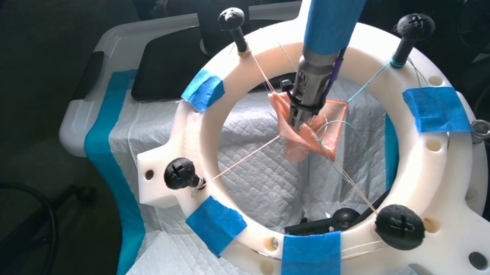
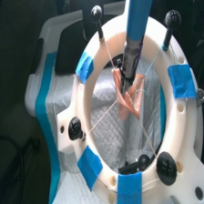
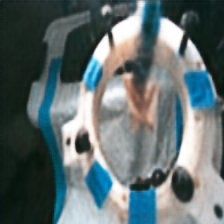

# Data card: inputs and targets of the actor–world model

Generated by `scripts/analysis/report_data.py` on 2026-11-25 at commit `dca3a51+uncommitted`; do not edit by hand, rerun the script:

```bash
python -m scripts.analysis.report_data 
```

- **Run:** `star-il-simplecnn-latent512-canonq-chunk16-trim-skip-hist-val1000-seed0` (its norm_stats.json, quat_reference.json, keep_ranges.csv; all train only)
- **Dataset:** `data/open_h/Surgical/jhu/imerse/star_il/star_il`; options: canonical quaternion True, chunk 16, state skip True, history True, keep ranges `configs/keep_ranges/star_il_tool_visible.csv`
- **Tables:** full train (146609 pairs) and val (17692 pairs). **Images and predictions:** first 3 episodes of each split. **Test split: never loaded.**
- **Worked example:** val pair t = row 463: episode 410, frame 67, the same pair in every section.
- **Checks:** all OK (each transformation recomputed in float64 from the raw values; a value passes within 4 × eps32 × its float32 magnitude).

## Summary

| item | shape | transformation | final range (train + val) | in [0, 1]? |
|---|---|---|---|---|
| image_input (frame t) | (224, 224, 3) float32 | decode, bilinear resize to 224 × 224 (uint8), / 255 | 0 … 1 | yes |
| next_image target (frame t+1) | (224, 224, 3) float32 | decode, bilinear resize to 224 × 224 (uint8), / 255 | 0 … 1 | yes |
| state_input (state t) | (8,) float32 | (s − mean) / std | -3.808 … 3.814 | no |
| next_state target (state t+1) | (8,) float32 | (s(t+1) − mean) / std | -3.808 … 3.798 | no |
| action_input (action t, world model) | (7,) float32 | canonical sign, (a − mean) / std | -4.221 … 3.433 | no |
| actor chunk target, step 1 (a(t) − a(t−1)) | (7,) float32 | canonical sign, (a(t+i) − a(t−1)) / scale[i, group] | -283.8 … 290.9 | no |
| actor chunk target, step 8 (a(t+7) − a(t−1)) | (7,) float32 | canonical sign, (a(t+i) − a(t−1)) / scale[i, group] | -51.11 … 60.14 | no |
| actor chunk target, step 16 (a(t+15) − a(t−1)) | (7,) float32 | canonical sign, (a(t+i) − a(t−1)) / scale[i, group] | -40.52 … 42.62 | no |
| history Δs(t) = s(t) − s(t−1) | (8,) float32 | (s(t) − s(t−1)) / std_s / std_Δs | -34.18 … 32.36 | no |
| history Δa(t−1) = a(t−1) − a(t−2) | (7,) float32 | canonical sign, (a(t−1) − a(t−2)) / std_a / std_Δa | -33.25 … 33.65 | no |
| language_input | (512,) float32 | constant 0 | 0 … 0 | yes |
| output: actor chunk | (16, 7) float32 | Dense, linear | -35.17 … 49.4 (val pred.) | no (unbounded) |
| output: next state | (8,) float32 | state + Dense, linear | -1.658 … 1.974 (val pred.) | no (unbounded) |
| output: next image | (224, 224, 3) float32 | sigmoid | 0.0002822 … 0.9999 (val pred.) | yes, (0, 1) |

## 1. image_input (frame t)

- **Role:** input of the shared encoder (actor and world model)
- **Shape, dtype:** (224, 224, 3) float32 (per pair; the model gets batches of these)
- **Raw source:** video `observation.images.endoscope.left` frame at row t: av1 yuv420p, 960×540, 30 fps

| dim | physical meaning | unit |
|---|---|---|
| `R` | red | 0–255 |
| `G` | green | 0–255 |
| `B` | blue | 0–255 |

**Raw values** (raw units, before any step)

| dim | unit | split | min | max | mean | std | p1 | p99 | % neg |
|---|---|---|---|---|---|---|---|---|---|
| `R` | 0–255 | train | 0 | 255 | 94.71 | 85.85 | 0 | 253 | 0.0 |
| `R` | 0–255 | val | 0 | 255 | 97.69 | 83.91 | 0 | 253 | 0.0 |
| `G` | 0–255 | train | 0 | 255 | 105.9 | 78.65 | 7 | 254 | 0.0 |
| `G` | 0–255 | val | 0 | 255 | 106.5 | 73.82 | 11 | 253 | 0.0 |
| `B` | 0–255 | train | 0 | 255 | 107.1 | 81.72 | 1 | 254 | 0.0 |
| `B` | 0–255 | val | 0 | 255 | 108.7 | 75.7 | 10 | 253 | 0.0 |

**Transformations, in order**

1. decode av1 yuv420p → rgb24 and resize 960×540 → 224×224 in one PyAV reformat (bilinear, the default; aspect ratio not kept). Code: [models/data.py:160](../models/data.py#L160). Statistics: none.
2. full splits: stored once as uint8 in the memory-mapped cache (subsets decode directly). Code: [models/data.py:500](../models/data.py#L500). Statistics: none.
3. get_pairs: `frames[t].astype(float32) / 255`. Code: [models/data.py:619](../models/data.py#L619). Statistics: none.

**Check** (the formulas above, recomputed here in float64 from the raw values, vs what `get_pairs` gives the model): max |difference| 2.945e-08 over 19418112 values, at most 0.124 × the float32 rounding bound → OK

**Final values** (what the model receives)

| dim | split | min | max | mean | std | p1 | p99 | % neg |
|---|---|---|---|---|---|---|---|---|
| `R` | train | 0 | 1 | 0.3688 | 0.3336 | 0 | 0.9882 | 0.0 |
| `R` | val | 0 | 1 | 0.3778 | 0.3269 | 0 | 0.9882 | 0.0 |
| `G` | train | 0.01569 | 1 | 0.4158 | 0.3061 | 0.03137 | 0.9961 | 0.0 |
| `G` | val | 0.02353 | 1 | 0.4181 | 0.2871 | 0.04314 | 0.9922 | 0.0 |
| `B` | train | 0 | 1 | 0.417 | 0.3184 | 0.007843 | 0.9882 | 0.0 |
| `B` | val | 0 | 1 | 0.4249 | 0.2938 | 0.03529 | 0.9882 | 0.0 |

**In [0, 1]? [-1, 1]? Unbounded?** By construction: [0, 1] (uint8 / 255). Measured: 0 … 1 → in [0, 1].

**Special cases**

- Images: only the first episodes of each split (frames: train 1320, val 1225; pairs: train 1046, val 890); raw = every 10th pair row.
- Resize: x ÷ 4.29, y ÷ 2.41: objects are squeezed horizontally by 1.78×.
- Only the left endoscope camera (the right video is an exact copy); episodes without that video are skipped (in these splits: train 0, val 0).
- Raw = after the decoder's YUV 4:2:0 → RGB conversion (the stored pixels are YUV).
- Frame cache (what training read): train: max |cache − direct decode| = 0 (uint8); val: max |cache − direct decode| = 0 (uint8).
- Keep ranges select the pairs, not the frames: the cache holds every frame.

**Example** (val pair t = row 463: episode 410, frame 67)

| dim | raw | final |
|---|---|---|
| `R` | 121 (frame mean 97.1) | 0.4784 (frame mean 0.3769) |
| `G` | 121 (frame mean 109.4) | 0.4863 (frame mean 0.4296) |
| `B` | 129 (frame mean 113.5) | 0.4980 (frame mean 0.4426) |

Native and model-input frame:  

**Model side**

- `image_input` ([models/simple_world_model/swm.py:46](../models/simple_world_model/swm.py#L46)) → simple_cnn, first layer Conv2D(32, 3, stride 2, relu) ([models/encoders.py:23](../models/encoders.py#L23)), no preprocessing layer: the encoder sees [0, 1] directly. Shared by the actor and the world model.

## 2. next_image target (frame t+1)

- **Role:** target of the world model's image decoder (`next_image_output`, MSE, weight 0.1)
- **Shape, dtype:** (224, 224, 3) float32 (per pair; the model gets batches of these)
- **Raw source:** video `observation.images.endoscope.left` frame at row t + 1: av1 yuv420p, 960×540, 30 fps

| dim | physical meaning | unit |
|---|---|---|
| `R` | red | 0–255 |
| `G` | green | 0–255 |
| `B` | blue | 0–255 |

**Raw values** (raw units, before any step)

| dim | unit | split | min | max | mean | std | p1 | p99 | % neg |
|---|---|---|---|---|---|---|---|---|---|
| `R` | 0–255 | train | 0 | 255 | 94.96 | 85.75 | 0 | 253 | 0.0 |
| `R` | 0–255 | val | 0 | 255 | 97.32 | 84.07 | 0 | 253 | 0.0 |
| `G` | 0–255 | train | 0 | 255 | 105.8 | 78.66 | 7 | 254 | 0.0 |
| `G` | 0–255 | val | 0 | 255 | 106.5 | 73.83 | 11 | 253 | 0.0 |
| `B` | 0–255 | train | 0 | 255 | 106.8 | 81.92 | 1 | 254 | 0.0 |
| `B` | 0–255 | val | 0 | 255 | 109 | 75.47 | 10 | 253 | 0.0 |

**Transformations, in order**

1. decode av1 yuv420p → rgb24 and resize 960×540 → 224×224 in one PyAV reformat (bilinear, the default; aspect ratio not kept). Code: [models/data.py:160](../models/data.py#L160). Statistics: none.
2. full splits: stored once as uint8 in the memory-mapped cache (subsets decode directly). Code: [models/data.py:500](../models/data.py#L500). Statistics: none.
3. get_pairs: `frames[t+1].astype(float32) / 255`. Code: [models/data.py:620](../models/data.py#L620). Statistics: none.

**Check** (the formulas above, recomputed here in float64 from the raw values, vs what `get_pairs` gives the model): max |difference| 2.945e-08 over 19418112 values, at most 0.124 × the float32 rounding bound → OK

**Final values** (what the model receives)

| dim | split | min | max | mean | std | p1 | p99 | % neg |
|---|---|---|---|---|---|---|---|---|
| `R` | train | 0 | 1 | 0.3689 | 0.3335 | 0 | 0.9882 | 0.0 |
| `R` | val | 0 | 1 | 0.3778 | 0.3269 | 0 | 0.9882 | 0.0 |
| `G` | train | 0.01569 | 1 | 0.4158 | 0.3061 | 0.03137 | 0.9961 | 0.0 |
| `G` | val | 0.02353 | 1 | 0.4181 | 0.2871 | 0.04314 | 0.9922 | 0.0 |
| `B` | train | 0 | 1 | 0.417 | 0.3184 | 0.007843 | 0.9882 | 0.0 |
| `B` | val | 0 | 1 | 0.4249 | 0.2938 | 0.03529 | 0.9882 | 0.0 |

**In [0, 1]? [-1, 1]? Unbounded?** By construction: [0, 1] (uint8 / 255). Measured: 0 … 1 → in [0, 1].

**Special cases**

- Images: only the first episodes of each split (frames: train 1320, val 1225; pairs: train 1046, val 890); raw = every 10th pair row.
- Resize: x ÷ 4.29, y ÷ 2.41: objects are squeezed horizontally by 1.78×.
- Only the left endoscope camera (the right video is an exact copy); episodes without that video are skipped (in these splits: train 0, val 0).
- Raw = after the decoder's YUV 4:2:0 → RGB conversion (the stored pixels are YUV).
- Frame cache (what training read): train: max |cache − direct decode| = 0 (uint8); val: max |cache − direct decode| = 0 (uint8).
- Keep ranges select the pairs, not the frames: the cache holds every frame.

**Example** (val pair t = row 463: episode 410, frame 67)

| dim | raw | final |
|---|---|---|
| `R` | 123 (frame mean 97.1) | 0.4784 (frame mean 0.3768) |
| `G` | 124 (frame mean 109.3) | 0.4863 (frame mean 0.4295) |
| `B` | 129 (frame mean 113.5) | 0.4902 (frame mean 0.4425) |

Native and model-input frame:  

**Model side**

- Compared with `next_image_output`, the decoder's last Conv2DTranspose(3, sigmoid) ([models/simple_world_model/swm.py:140](../models/simple_world_model/swm.py#L140)); loss MSE.

## 3. state_input (state t)

- **Role:** input of both branches (actor and world model)
- **Shape, dtype:** (8,) float32 (per pair; the model gets batches of these)
- **Raw source:** `observation.state` at row t

| dim | physical meaning | unit |
|---|---|---|
| `kuka_joint_pos[0]` | KUKA LBR iiwa joint 0 angle | rad |
| `kuka_joint_pos[1]` | KUKA LBR iiwa joint 1 angle | rad |
| `kuka_joint_pos[2]` | KUKA LBR iiwa joint 2 angle | rad |
| `kuka_joint_pos[3]` | KUKA LBR iiwa joint 3 angle | rad |
| `kuka_joint_pos[4]` | KUKA LBR iiwa joint 4 angle | rad |
| `kuka_joint_pos[5]` | KUKA LBR iiwa joint 5 angle | rad |
| `kuka_joint_pos[6]` | KUKA LBR iiwa joint 6 angle | rad |
| `endo360_joint_pos[0]` | Endo360 needle-driver joint 0 (the tool, not the camera) | rad |

**Raw values** (raw units, before any step)

| dim | unit | split | min | max | mean | std | p1 | p99 | % neg |
|---|---|---|---|---|---|---|---|---|---|
| `kuka_joint_pos[0]` | rad | train | -0.6493 | 0.6157 | -0.008289 | 0.2291 | -0.5051 | 0.4468 | 50.6 |
| `kuka_joint_pos[0]` | rad | val | -0.4981 | 0.3847 | -0.01758 | 0.24 | -0.4683 | 0.3787 | 49.0 |
| `kuka_joint_pos[1]` | rad | train | -0.7844 | 0.2142 | -0.3553 | 0.1477 | -0.7478 | -0.02298 | 99.3 |
| `kuka_joint_pos[1]` | rad | val | -0.8539 | 0.09656 | -0.3793 | 0.1617 | -0.8401 | -0.01692 | 99.3 |
| `kuka_joint_pos[2]` | rad | train | -0.6381 | 0.3664 | -0.1613 | 0.2356 | -0.5907 | 0.2321 | 67.9 |
| `kuka_joint_pos[2]` | rad | val | -0.5902 | 0.2951 | -0.1901 | 0.2398 | -0.5873 | 0.2924 | 74.6 |
| `kuka_joint_pos[3]` | rad | train | 0.6492 | 1.886 | 1.287 | 0.1838 | 0.7683 | 1.694 | 0.0 |
| `kuka_joint_pos[3]` | rad | val | 0.586 | 1.751 | 1.254 | 0.2143 | 0.6133 | 1.746 | 0.0 |
| `kuka_joint_pos[4]` | rad | train | -0.4261 | 0.2709 | -0.04284 | 0.1159 | -0.3235 | 0.2141 | 64.8 |
| `kuka_joint_pos[4]` | rad | val | -0.2498 | 0.2512 | -0.01001 | 0.1048 | -0.2473 | 0.2461 | 57.4 |
| `kuka_joint_pos[5]` | rad | train | -1.95 | -1.153 | -1.57 | 0.1097 | -1.843 | -1.27 | 100.0 |
| `kuka_joint_pos[5]` | rad | val | -1.927 | -1.284 | -1.586 | 0.1268 | -1.894 | -1.289 | 100.0 |
| `kuka_joint_pos[6]` | rad | train | -2.858 | 0.6248 | -1.263 | 0.9613 | -2.676 | 0.5782 | 80.3 |
| `kuka_joint_pos[6]` | rad | val | -2.636 | 0.5424 | -1.332 | 0.9257 | -2.634 | 0.5411 | 81.4 |
| `endo360_joint_pos[0]` | rad | train | -0.3562 | 0.3962 | 0.01783 | 0.1419 | -0.2738 | 0.3599 | 39.8 |
| `endo360_joint_pos[0]` | rad | val | -0.3956 | 0.2848 | 0.002714 | 0.1364 | -0.3938 | 0.2835 | 43.2 |

**Transformations, in order**

1. read the parquet column `observation.state` (float32). Code: [models/data.py:69](../models/data.py#L69). Statistics: none.
2. keep ranges + pair rule: t only where the whole window (a(t-1) .. a(t+k-1), s(t+1)) lies in the episode's kept rows; selects rows, changes no value. Code: [models/data.py:137](../models/data.py#L137), [models/data.py:576](../models/data.py#L576). Statistics: keep_ranges.csv (copied into the run, hash-checked).
3. normalise: s_n = (s - mean) / (std + 1e-8), std floored at 1e-6. Code: [models/data.py:169](../models/data.py#L169), called in [models/data.py:571](../models/data.py#L571). Statistics: norm_stats.json `observation.state` mean/std: train episodes, kept rows only ([models/data.py:193](../models/data.py#L193)).
4. get_pairs: `data["states"][t]`. Code: [models/data.py:623](../models/data.py#L623). Statistics: none.

**Check** (the formulas above, recomputed here in float64 from the raw values, vs what `get_pairs` gives the model): max |difference| 4.226e-07 over 1314408 values, at most 0.1425 × the float32 rounding bound → OK

**Final values** (what the model receives)

| dim | split | min | max | mean | std | p1 | p99 | % neg |
|---|---|---|---|---|---|---|---|---|
| `kuka_joint_pos[0]` | train | -2.8 | 2.722 | -0.001793 | 1 | -2.171 | 1.985 | 48.0 |
| `kuka_joint_pos[0]` | val | -2.14 | 1.714 | -0.04234 | 1.048 | -2.01 | 1.687 | 47.7 |
| `kuka_joint_pos[1]` | train | -2.906 | 3.814 | -0.01855 | 0.9941 | -2.659 | 2.218 | 51.6 |
| `kuka_joint_pos[1]` | val | -3.374 | 3.022 | -0.1795 | 1.088 | -3.28 | 2.259 | 57.1 |
| `kuka_joint_pos[2]` | train | -2.021 | 2.238 | 0.0008433 | 0.999 | -1.82 | 1.669 | 45.5 |
| `kuka_joint_pos[2]` | val | -1.818 | 1.936 | -0.1214 | 1.017 | -1.806 | 1.925 | 52.6 |
| `kuka_joint_pos[3]` | train | -3.464 | 3.257 | 0.002747 | 0.9987 | -2.817 | 2.215 | 49.4 |
| `kuka_joint_pos[3]` | val | -3.808 | 2.52 | -0.1774 | 1.164 | -3.659 | 2.495 | 52.2 |
| `kuka_joint_pos[4]` | train | -3.316 | 2.714 | -8.316e-05 | 1.002 | -2.428 | 2.223 | 50.0 |
| `kuka_joint_pos[4]` | val | -1.791 | 2.544 | 0.2839 | 0.9067 | -1.769 | 2.5 | 35.4 |
| `kuka_joint_pos[5]` | train | -3.439 | 3.798 | 0.01349 | 0.9974 | -2.467 | 2.74 | 48.7 |
| `kuka_joint_pos[5]` | val | -3.237 | 2.607 | -0.1315 | 1.152 | -2.93 | 2.567 | 52.2 |
| `kuka_joint_pos[6]` | train | -1.66 | 1.959 | -0.002422 | 0.9989 | -1.471 | 1.911 | 63.8 |
| `kuka_joint_pos[6]` | val | -1.43 | 1.873 | -0.07416 | 0.962 | -1.427 | 1.872 | 64.7 |
| `endo360_joint_pos[0]` | train | -2.669 | 2.71 | 0.004931 | 1.014 | -2.08 | 2.45 | 43.8 |
| `endo360_joint_pos[0]` | val | -2.951 | 1.913 | -0.1031 | 0.9747 | -2.938 | 1.904 | 49.6 |

**In [0, 1]? [-1, 1]? Unbounded?** By construction: unbounded (z-score of an angle in rad). Measured: -3.808 … 3.814 → not in [-1, 1]: 35.3% of values outside (worst split).

**Special cases**

- Pairs: train 146609 of 167491 untrimmed, val 17692 of 19346 untrimmed.
- No quaternion in `observation.state` (quat_reference.json lists none): the canonical-sign step is a no-op here.
- `endo360_joint_pos[0]` is the Endo360 needle driver (the tool), not the camera; it is not commanded by the action.
- One-frame glitches (`references.glitch_frames`, jump > 5 × train p99 that comes back), frames per split: `endo360_joint_pos[0]`: train 32, val 4.
- Normalised mean / std are not exactly 0 / 1: the norm statistics use every kept row of the train episodes, these tables only the pair rows t (and val is another set of episodes).
- Tails (|final|): train: > 5: 0.00%, > 10: 0.00%; val: > 5: 0.00%, > 10: 0.00%. Largest |value| 3.814: `kuka_joint_pos[1]`, train episode 194, frame 40.
- Tails (|final|): train: > 5: 0.00%, > 10: 0.00%; val: > 5: 0.00%, > 10: 0.00%. Largest |value| 3.808: `kuka_joint_pos[3]`, val episode 456, frame 46.

**Example** (val pair t = row 463: episode 410, frame 67)

| dim | raw | final |
|---|---|---|
| `kuka_joint_pos[0]` | 0.06868 | 0.3342 |
| `kuka_joint_pos[1]` | -0.2064 | 0.9835 |
| `kuka_joint_pos[2]` | -0.0475 | 0.4833 |
| `kuka_joint_pos[3]` | 1.487 | 1.087 |
| `kuka_joint_pos[4]` | -0.1652 | -1.058 |
| `kuka_joint_pos[5]` | -1.467 | 0.9509 |
| `kuka_joint_pos[6]` | -0.827 | 0.4505 |
| `endo360_joint_pos[0]` | 0.1363 | 0.8519 |

**Model side**

- `state_input` ([models/simple_world_model/swm.py:47](../models/simple_world_model/swm.py#L47)) is read by the actor's Concatenate ([models/simple_world_model/swm.py:59](../models/simple_world_model/swm.py#L59)) and the WM's Concatenate ([models/simple_world_model/swm.py:99](../models/simple_world_model/swm.py#L99)): raw, no layer in between.
- State skip (1a): also added directly to the state head's output, next_state = state_input + Dense(s_x) ([models/simple_world_model/swm.py:116](../models/simple_world_model/swm.py#L116)).

## 4. next_state target (state t+1)

- **Role:** target of the world model's state head (`next_state_output`, MSE, weight 1.0)
- **Shape, dtype:** (8,) float32 (per pair; the model gets batches of these)
- **Raw source:** `observation.state` at row t + 1

| dim | physical meaning | unit |
|---|---|---|
| `kuka_joint_pos[0]` | KUKA LBR iiwa joint 0 angle | rad |
| `kuka_joint_pos[1]` | KUKA LBR iiwa joint 1 angle | rad |
| `kuka_joint_pos[2]` | KUKA LBR iiwa joint 2 angle | rad |
| `kuka_joint_pos[3]` | KUKA LBR iiwa joint 3 angle | rad |
| `kuka_joint_pos[4]` | KUKA LBR iiwa joint 4 angle | rad |
| `kuka_joint_pos[5]` | KUKA LBR iiwa joint 5 angle | rad |
| `kuka_joint_pos[6]` | KUKA LBR iiwa joint 6 angle | rad |
| `endo360_joint_pos[0]` | Endo360 needle-driver joint 0 (the tool, not the camera) | rad |

**Raw values** (raw units, before any step)

| dim | unit | split | min | max | mean | std | p1 | p99 | % neg |
|---|---|---|---|---|---|---|---|---|---|
| `kuka_joint_pos[0]` | rad | train | -0.6493 | 0.6157 | -0.008307 | 0.2291 | -0.5051 | 0.4468 | 50.6 |
| `kuka_joint_pos[0]` | rad | val | -0.4981 | 0.3847 | -0.01759 | 0.24 | -0.4683 | 0.3786 | 49.0 |
| `kuka_joint_pos[1]` | rad | train | -0.7844 | 0.2117 | -0.3553 | 0.1478 | -0.7478 | -0.02293 | 99.3 |
| `kuka_joint_pos[1]` | rad | val | -0.8539 | 0.09342 | -0.3792 | 0.1618 | -0.8401 | -0.01685 | 99.3 |
| `kuka_joint_pos[2]` | rad | train | -0.638 | 0.3662 | -0.1613 | 0.2356 | -0.5907 | 0.2321 | 67.9 |
| `kuka_joint_pos[2]` | rad | val | -0.5903 | 0.2952 | -0.1901 | 0.2398 | -0.5873 | 0.2924 | 74.6 |
| `kuka_joint_pos[3]` | rad | train | 0.6496 | 1.886 | 1.287 | 0.1838 | 0.7683 | 1.695 | 0.0 |
| `kuka_joint_pos[3]` | rad | val | 0.586 | 1.751 | 1.254 | 0.2143 | 0.6133 | 1.746 | 0.0 |
| `kuka_joint_pos[4]` | rad | train | -0.4261 | 0.2709 | -0.04283 | 0.1159 | -0.3235 | 0.2141 | 64.8 |
| `kuka_joint_pos[4]` | rad | val | -0.2498 | 0.2512 | -0.01001 | 0.1048 | -0.2473 | 0.2461 | 57.4 |
| `kuka_joint_pos[5]` | rad | train | -1.949 | -1.153 | -1.57 | 0.1097 | -1.843 | -1.269 | 100.0 |
| `kuka_joint_pos[5]` | rad | val | -1.927 | -1.284 | -1.586 | 0.1268 | -1.894 | -1.289 | 100.0 |
| `kuka_joint_pos[6]` | rad | train | -2.858 | 0.6248 | -1.263 | 0.9613 | -2.676 | 0.5782 | 80.3 |
| `kuka_joint_pos[6]` | rad | val | -2.636 | 0.5419 | -1.332 | 0.9257 | -2.634 | 0.5411 | 81.4 |
| `endo360_joint_pos[0]` | rad | train | -0.3562 | 0.3962 | 0.01783 | 0.1419 | -0.2738 | 0.3599 | 39.8 |
| `endo360_joint_pos[0]` | rad | val | -0.3956 | 0.2848 | 0.002715 | 0.1364 | -0.3938 | 0.2835 | 43.2 |

**Transformations, in order**

1. read the parquet column `observation.state` (float32). Code: [models/data.py:69](../models/data.py#L69). Statistics: none.
2. keep ranges + pair rule: t only where the whole window (a(t-1) .. a(t+k-1), s(t+1)) lies in the episode's kept rows; selects rows, changes no value. Code: [models/data.py:137](../models/data.py#L137), [models/data.py:576](../models/data.py#L576). Statistics: keep_ranges.csv (copied into the run, hash-checked).
3. normalise: s_n = (s - mean) / (std + 1e-8), std floored at 1e-6. Code: [models/data.py:169](../models/data.py#L169), called in [models/data.py:571](../models/data.py#L571). Statistics: norm_stats.json `observation.state` mean/std: train episodes, kept rows only ([models/data.py:193](../models/data.py#L193)).
4. get_pairs: `data["states"][t + 1]`. Code: [models/data.py:629](../models/data.py#L629). Statistics: none.

**Check** (the formulas above, recomputed here in float64 from the raw values, vs what `get_pairs` gives the model): max |difference| 4.226e-07 over 1314408 values, at most 0.1425 × the float32 rounding bound → OK

**Final values** (what the model receives)

| dim | split | min | max | mean | std | p1 | p99 | % neg |
|---|---|---|---|---|---|---|---|---|
| `kuka_joint_pos[0]` | train | -2.8 | 2.722 | -0.001871 | 1 | -2.171 | 1.985 | 48.0 |
| `kuka_joint_pos[0]` | val | -2.14 | 1.714 | -0.04241 | 1.048 | -2.01 | 1.687 | 47.7 |
| `kuka_joint_pos[1]` | train | -2.906 | 3.797 | -0.01798 | 0.9943 | -2.659 | 2.218 | 51.6 |
| `kuka_joint_pos[1]` | val | -3.374 | 3.001 | -0.1788 | 1.089 | -3.28 | 2.259 | 57.1 |
| `kuka_joint_pos[2]` | train | -2.021 | 2.238 | 0.0008263 | 0.999 | -1.82 | 1.669 | 45.5 |
| `kuka_joint_pos[2]` | val | -1.818 | 1.936 | -0.1215 | 1.017 | -1.806 | 1.925 | 52.6 |
| `kuka_joint_pos[3]` | train | -3.462 | 3.257 | 0.003079 | 0.9988 | -2.817 | 2.216 | 49.3 |
| `kuka_joint_pos[3]` | val | -3.808 | 2.52 | -0.1771 | 1.164 | -3.659 | 2.495 | 52.2 |
| `kuka_joint_pos[4]` | train | -3.316 | 2.714 | -1.25e-05 | 1.002 | -2.428 | 2.223 | 50.0 |
| `kuka_joint_pos[4]` | val | -1.791 | 2.544 | 0.2839 | 0.9067 | -1.769 | 2.5 | 35.4 |
| `kuka_joint_pos[5]` | train | -3.435 | 3.798 | 0.01386 | 0.9973 | -2.467 | 2.742 | 48.7 |
| `kuka_joint_pos[5]` | val | -3.237 | 2.607 | -0.1311 | 1.152 | -2.93 | 2.567 | 52.2 |
| `kuka_joint_pos[6]` | train | -1.66 | 1.959 | -0.002448 | 0.9989 | -1.471 | 1.911 | 63.8 |
| `kuka_joint_pos[6]` | val | -1.43 | 1.873 | -0.0742 | 0.962 | -1.427 | 1.872 | 64.7 |
| `endo360_joint_pos[0]` | train | -2.669 | 2.71 | 0.004927 | 1.014 | -2.08 | 2.45 | 43.8 |
| `endo360_joint_pos[0]` | val | -2.951 | 1.913 | -0.1031 | 0.9749 | -2.938 | 1.904 | 49.6 |

**In [0, 1]? [-1, 1]? Unbounded?** By construction: unbounded (z-score of an angle in rad). Measured: -3.808 … 3.798 → not in [-1, 1]: 35.3% of values outside (worst split).

**Special cases**

- Pairs: train 146609 of 167491 untrimmed, val 17692 of 19346 untrimmed.
- No quaternion in `observation.state` (quat_reference.json lists none): the canonical-sign step is a no-op here.
- `endo360_joint_pos[0]` is the Endo360 needle driver (the tool), not the camera; it is not commanded by the action.
- One-frame glitches (`references.glitch_frames`, jump > 5 × train p99 that comes back), frames per split: `endo360_joint_pos[0]`: train 32, val 4.
- Normalised mean / std are not exactly 0 / 1: the norm statistics use every kept row of the train episodes, these tables only the pair rows t (and val is another set of episodes).
- Tails (|final|): train: > 5: 0.00%, > 10: 0.00%; val: > 5: 0.00%, > 10: 0.00%. Largest |value| 3.814: `kuka_joint_pos[1]`, train episode 194, frame 40.
- Tails (|final|): train: > 5: 0.00%, > 10: 0.00%; val: > 5: 0.00%, > 10: 0.00%. Largest |value| 3.808: `kuka_joint_pos[3]`, val episode 456, frame 46.

**Example** (val pair t = row 463: episode 410, frame 67)

| dim | raw | final |
|---|---|---|
| `kuka_joint_pos[0]` | 0.06826 | 0.3323 |
| `kuka_joint_pos[1]` | -0.2076 | 0.9759 |
| `kuka_joint_pos[2]` | -0.0475 | 0.4833 |
| `kuka_joint_pos[3]` | 1.487 | 1.087 |
| `kuka_joint_pos[4]` | -0.1655 | -1.061 |
| `kuka_joint_pos[5]` | -1.467 | 0.9511 |
| `kuka_joint_pos[6]` | -0.827 | 0.4505 |
| `endo360_joint_pos[0]` | 0.1369 | 0.8563 |

**Model side**

- Compared with `next_state_output` ([models/simple_world_model/swm.py:116](../models/simple_world_model/swm.py#L116)); loss MSE ([models/run_config.py:156](../models/run_config.py#L156)).

## 5. action_input (action t, world model)

- **Role:** input of the world model only
- **Shape, dtype:** (7,) float32 (per pair; the model gets batches of these)
- **Raw source:** `action` at row t

| dim | physical meaning | unit |
|---|---|---|
| `kuka_pose.x` | commanded end-effector position x | m |
| `kuka_pose.y` | commanded end-effector position y | m |
| `kuka_pose.z` | commanded end-effector position z | m |
| `kuka_pose.ori.x` | commanded end-effector orientation, quaternion x | 1 (unit quaternion) |
| `kuka_pose.ori.y` | commanded end-effector orientation, quaternion y | 1 (unit quaternion) |
| `kuka_pose.ori.z` | commanded end-effector orientation, quaternion z | 1 (unit quaternion) |
| `kuka_pose.ori.w` | commanded end-effector orientation, quaternion w | 1 (unit quaternion) |

**Raw values** (raw units, before any step)

| dim | unit | split | min | max | mean | std | p1 | p99 | % neg |
|---|---|---|---|---|---|---|---|---|---|
| `kuka_pose.x` | m | train | -0.5666 | -0.4105 | -0.4802 | 0.02397 | -0.5375 | -0.4233 | 100.0 |
| `kuka_pose.x` | m | val | -0.5388 | -0.4128 | -0.4823 | 0.0239 | -0.5254 | -0.4158 | 100.0 |
| `kuka_pose.y` | m | train | 0.06896 | 0.1976 | 0.1297 | 0.02346 | 0.08254 | 0.1863 | 0.0 |
| `kuka_pose.y` | m | val | 0.07832 | 0.2002 | 0.1292 | 0.02453 | 0.08676 | 0.1974 | 0.0 |
| `kuka_pose.z` | m | train | -0.08926 | 0.02961 | -0.04156 | 0.01942 | -0.08175 | 0.009317 | 96.8 |
| `kuka_pose.z` | m | val | -0.08831 | 0.02255 | -0.04248 | 0.0193 | -0.08514 | 0.008939 | 97.2 |
| `kuka_pose.ori.x` | 1 (unit quaternion) | train | -0.7071 | 0.9674 | 0.1522 | 0.6085 | -0.7022 | 0.9395 | 39.3 |
| `kuka_pose.ori.x` | 1 (unit quaternion) | val | -0.7053 | 0.9494 | 0.122 | 0.6198 | -0.7017 | 0.9406 | 43.1 |
| `kuka_pose.ori.y` | 1 (unit quaternion) | train | -0.707 | 0.9977 | 0.3023 | 0.7099 | -0.702 | 0.997 | 39.3 |
| `kuka_pose.ori.y` | 1 (unit quaternion) | val | -0.7063 | 0.9893 | 0.3119 | 0.702 | -0.702 | 0.9837 | 38.2 |
| `kuka_pose.ori.z` | 1 (unit quaternion) | train | -0.2469 | 0.2632 | 0.01707 | 0.06278 | -0.1513 | 0.1654 | 34.7 |
| `kuka_pose.ori.z` | 1 (unit quaternion) | val | -0.2061 | 0.1908 | 0.007499 | 0.06413 | -0.2049 | 0.1774 | 41.8 |
| `kuka_pose.ori.w` | 1 (unit quaternion) | train | -0.286 | 0.2228 | -0.003711 | 0.08268 | -0.18 | 0.1781 | 56.3 |
| `kuka_pose.ori.w` | 1 (unit quaternion) | val | -0.1813 | 0.2274 | 0.00192 | 0.08151 | -0.176 | 0.22 | 55.7 |

**Transformations, in order**

1. read the parquet column `action` (float32). Code: [models/data.py:70](../models/data.py#L70). Statistics: none.
2. canonical quaternion sign: q -> -q where q·q_ref < 0, q_ref = [-0.582, 0.8121, 0.0065, 0.042]. Code: [models/data.py:411](../models/data.py#L411), called in [models/data.py:73](../models/data.py#L73). Statistics: q_ref = Markley mean of the train kept rows ([models/data.py:392](../models/data.py#L392)), quat_reference.json.
3. keep ranges + pair rule: t only where the whole window (a(t-1) .. a(t+k-1), s(t+1)) lies in the episode's kept rows; selects rows, changes no value. Code: [models/data.py:137](../models/data.py#L137), [models/data.py:576](../models/data.py#L576). Statistics: keep_ranges.csv (copied into the run, hash-checked).
4. normalise: a_n = (a - mean) / (std + 1e-8), std floored at 1e-6. Code: [models/data.py:169](../models/data.py#L169), called in [models/data.py:572](../models/data.py#L572). Statistics: norm_stats.json `action` mean/std: train episodes, kept rows only ([models/data.py:193](../models/data.py#L193)).
5. get_pairs: `data["actions"][t]`. Code: [models/data.py:625](../models/data.py#L625). Statistics: none.

**Check** (the formulas above, recomputed here in float64 from the raw values, vs what `get_pairs` gives the model): max |difference| 5.057e-07 over 1150107 values, at most 0.1569 × the float32 rounding bound → OK

**Final values** (what the model receives)

| dim | split | min | max | mean | std | p1 | p99 | % neg |
|---|---|---|---|---|---|---|---|---|
| `kuka_pose.x` | train | -3.585 | 2.913 | 0.009151 | 0.9975 | -2.375 | 2.378 | 48.2 |
| `kuka_pose.x` | val | -2.426 | 2.815 | -0.07544 | 0.9946 | -1.871 | 2.691 | 55.5 |
| `kuka_pose.y` | train | -2.574 | 2.888 | 0.007041 | 0.9963 | -1.997 | 2.409 | 52.6 |
| `kuka_pose.y` | val | -2.176 | 2.997 | -0.01627 | 1.042 | -1.818 | 2.882 | 51.4 |
| `kuka_pose.z` | train | -2.386 | 3.376 | -0.07407 | 0.9415 | -2.022 | 2.393 | 59.5 |
| `kuka_pose.z` | val | -2.34 | 3.034 | -0.1187 | 0.9355 | -2.186 | 2.374 | 64.4 |
| `kuka_pose.ori.x` | train | -1.207 | 2.235 | -0.002349 | 0.9989 | -1.138 | 2.128 | 65.9 |
| `kuka_pose.ori.x` | val | -1.162 | 2.165 | -0.03972 | 0.9707 | -1.141 | 2.153 | 65.2 |
| `kuka_pose.ori.y` | train | -2.869 | 1.406 | -0.002779 | 0.9993 | -2.428 | 1.402 | 51.6 |
| `kuka_pose.ori.y` | val | -2.555 | 1.358 | -0.01749 | 0.9751 | -2.466 | 1.326 | 50.4 |
| `kuka_pose.ori.z` | train | -4.221 | 2.626 | -0.01326 | 1.008 | -3.054 | 2.184 | 42.4 |
| `kuka_pose.ori.z` | val | -3.331 | 2.851 | -0.03954 | 1.002 | -3.313 | 2.643 | 46.8 |
| `kuka_pose.ori.w` | train | -3.661 | 3.433 | 0.006785 | 1.009 | -2.273 | 2.132 | 50.2 |
| `kuka_pose.ori.w` | val | -2.022 | 2.617 | 0.05586 | 0.9594 | -1.949 | 2.514 | 46.4 |

**In [0, 1]? [-1, 1]? Unbounded?** By construction: unbounded (z-score). Measured: -4.221 … 3.433 → not in [-1, 1]: 31.8% of values outside (worst split).

**Special cases**

- Pairs: train 146609 of 167491 untrimmed, val 17692 of 19346 untrimmed.
- Canonical quaternion: share of pair rows whose sign is flipped: train 39.3%, val 38.2%; the furthest train orientation is 122.7° from q_ref (sign ambiguous only near 180°).
- The action is a commanded pose (7-D, one arm); the Endo360 joint has no command.
- Normalised mean / std are not exactly 0 / 1: the norm statistics use every kept row of the train episodes, these tables only the pair rows t (and val is another set of episodes).
- Tails (|final|): train: > 5: 0.00%, > 10: 0.00%; val: > 5: 0.00%, > 10: 0.00%. Largest |value| 4.221: `kuka_pose.ori.z`, train episode 152, frame 191.

**Example** (val pair t = row 463: episode 410, frame 67)

| dim | raw | final |
|---|---|---|
| `kuka_pose.x` | -0.4756 | 0.2042 |
| `kuka_pose.y` | 0.111 | -0.7892 |
| `kuka_pose.z` | -0.04541 | -0.2605 |
| `kuka_pose.ori.x` | -0.4231 | 0.1352 |
| `kuka_pose.ori.y` | 0.9046 | 0.8734 |
| `kuka_pose.ori.z` | 0.04766 | 0.6216 |
| `kuka_pose.ori.w` | -0.01953 | -0.8261 |

**Model side**

- `action_input` ([models/simple_world_model/swm.py:49](../models/simple_world_model/swm.py#L49)) is read only by the WM's Concatenate ([models/simple_world_model/swm.py:99](../models/simple_world_model/swm.py#L99)); the actor never sees a(t).

## 6. actor chunk target, step 1 (a(t) − a(t−1))

- **Role:** target of the actor (`action_output[:, 0]`, Huber, weight 1.0)
- **Shape, dtype:** (7,) float32 (per pair; the model gets batches of these)
- **Raw source:** `action` at rows t + 0 and t − 1

| dim | physical meaning | unit |
|---|---|---|
| `kuka_pose.x` | commanded end-effector position x | m |
| `kuka_pose.y` | commanded end-effector position y | m |
| `kuka_pose.z` | commanded end-effector position z | m |
| `kuka_pose.ori.x` | commanded end-effector orientation, quaternion x | 1 (unit quaternion) |
| `kuka_pose.ori.y` | commanded end-effector orientation, quaternion y | 1 (unit quaternion) |
| `kuka_pose.ori.z` | commanded end-effector orientation, quaternion z | 1 (unit quaternion) |
| `kuka_pose.ori.w` | commanded end-effector orientation, quaternion w | 1 (unit quaternion) |

**Raw values** (raw units, before any step)

| dim | unit | split | min | max | mean | std | p1 | p99 | % neg |
|---|---|---|---|---|---|---|---|---|---|
| `kuka_pose.x` | m | train | -0.004216 | 0.004262 | -1.252e-05 | 0.0003127 | -0.0009405 | 0.0009072 | 51.7 |
| `kuka_pose.x` | m | val | -0.004829 | 0.004795 | -1.704e-05 | 0.0002999 | -0.0008678 | 0.0008379 | 53.2 |
| `kuka_pose.y` | m | train | -0.006768 | 0.005784 | 2.709e-06 | 0.0002909 | -0.0008318 | 0.0008542 | 49.8 |
| `kuka_pose.y` | m | val | -0.005373 | 0.005838 | 7.51e-06 | 0.0003008 | -0.0008651 | 0.0008816 | 48.9 |
| `kuka_pose.z` | m | train | -0.002878 | 0.003299 | 1.39e-05 | 0.000395 | -0.0009999 | 0.00119 | 50.4 |
| `kuka_pose.z` | m | val | -0.001896 | 0.002193 | 2.387e-05 | 0.0003747 | -0.0009578 | 0.001098 | 48.8 |
| `kuka_pose.ori.x` | 1 (unit quaternion) | train | -1.414 | 1.417 | -4.464e-05 | 0.02751 | -0.0008036 | 0.0006766 | 50.8 |
| `kuka_pose.ori.x` | 1 (unit quaternion) | val | -1.411 | 1.41 | -7.196e-06 | 0.015 | -0.0007295 | 0.0006845 | 50.8 |
| `kuka_pose.ori.y` | 1 (unit quaternion) | train | -1.414 | 1.414 | 3.378e-05 | 0.02751 | -0.0009201 | 0.0007613 | 50.0 |
| `kuka_pose.ori.y` | 1 (unit quaternion) | val | -1.41 | 1.411 | -6.67e-06 | 0.015 | -0.0008728 | 0.000678 | 49.9 |
| `kuka_pose.ori.z` | 1 (unit quaternion) | train | -0.1915 | 0.1639 | -5.226e-06 | 0.002259 | -0.004437 | 0.004378 | 50.1 |
| `kuka_pose.ori.z` | 1 (unit quaternion) | val | -0.1209 | 0.1489 | -2.143e-06 | 0.002105 | -0.00447 | 0.004474 | 51.4 |
| `kuka_pose.ori.w` | 1 (unit quaternion) | train | -0.3278 | 0.2956 | 8.947e-06 | 0.003876 | -0.00485 | 0.004935 | 49.6 |
| `kuka_pose.ori.w` | 1 (unit quaternion) | val | -0.05511 | 0.06479 | 7.481e-07 | 0.001993 | -0.005051 | 0.005295 | 49.2 |

**Transformations, in order**

1. read the parquet column `action` (float32). Code: [models/data.py:70](../models/data.py#L70). Statistics: none.
2. canonical quaternion sign: q -> -q where q·q_ref < 0, q_ref = [-0.582, 0.8121, 0.0065, 0.042]. Code: [models/data.py:411](../models/data.py#L411), called in [models/data.py:73](../models/data.py#L73). Statistics: q_ref = Markley mean of the train kept rows ([models/data.py:392](../models/data.py#L392)), quat_reference.json.
3. keep ranges + pair rule: t only where the whole window (a(t-1) .. a(t+k-1), s(t+1)) lies in the episode's kept rows; selects rows, changes no value. Code: [models/data.py:137](../models/data.py#L137), [models/data.py:576](../models/data.py#L576). Statistics: keep_ranges.csv (copied into the run, hash-checked).
4. normalise: a_n = (a - mean) / (std + 1e-8), std floored at 1e-6. Code: [models/data.py:169](../models/data.py#L169), called in [models/data.py:572](../models/data.py#L572). Statistics: norm_stats.json `action` mean/std: train episodes, kept rows only ([models/data.py:193](../models/data.py#L193)).
5. chunk offset: y_i = (a_n(t+i) − a_n(t−1)) × F_i, F_i = (std + 1e-8) / scale[i, group] = o_i / scale[i, group] in raw units. Code: [models/data.py:612](../models/data.py#L612), F: [models/data.py:284](../models/data.py#L284). Statistics: norm_stats.json `action_chunk`: per step and group (x+y+z, x+y+z+w) max(median, 0.25 × mean) of the offset norm over train pairs ([models/data.py:266](../models/data.py#L266)); step 1: x+y+z 0.0002655, x+y+z+w 0.0001977.

**Check** (the formulas above, recomputed here in float64 from the raw values, vs what `get_pairs` gives the model): max |difference| 0.0007582 over 1150107 values, at most 0.2171 × the float32 rounding bound → OK

**Final values** (what the model receives)

| dim | split | min | max | mean | std | p1 | p99 | % neg |
|---|---|---|---|---|---|---|---|---|
| `kuka_pose.x` | train | -15.88 | 16.05 | -0.04717 | 1.178 | -3.542 | 3.417 | 51.7 |
| `kuka_pose.x` | val | -18.19 | 18.06 | -0.06417 | 1.129 | -3.268 | 3.156 | 53.2 |
| `kuka_pose.y` | train | -25.49 | 21.79 | 0.0102 | 1.096 | -3.133 | 3.217 | 49.8 |
| `kuka_pose.y` | val | -20.24 | 21.99 | 0.02829 | 1.133 | -3.258 | 3.321 | 48.9 |
| `kuka_pose.z` | train | -10.84 | 12.43 | 0.05235 | 1.488 | -3.766 | 4.483 | 50.4 |
| `kuka_pose.z` | val | -7.141 | 8.258 | 0.0899 | 1.411 | -3.607 | 4.134 | 48.8 |
| `kuka_pose.ori.x` | train | -42.01 | 32.89 | -0.01142 | 1.403 | -3.527 | 3.853 | 53.3 |
| `kuka_pose.ori.x` | val | -38.42 | 31.54 | -0.03587 | 1.414 | -3.286 | 3.817 | 53.3 |
| `kuka_pose.ori.y` | train | -49.38 | 50 | 0.002885 | 1.483 | -4.025 | 4.367 | 51.9 |
| `kuka_pose.ori.y` | val | -25.1 | 26.6 | -0.001094 | 1.252 | -3.566 | 3.967 | 52.1 |
| `kuka_pose.ori.z` | train | -263.2 | 261.2 | 0.05584 | 7.911 | -21.72 | 22.32 | 46.1 |
| `kuka_pose.ori.z` | val | -259.6 | 265.6 | 0.09254 | 7.755 | -22.19 | 22.71 | 45.2 |
| `kuka_pose.ori.w` | train | -283.8 | 290.9 | -0.1436 | 9.081 | -23.97 | 25.02 | 52.1 |
| `kuka_pose.ori.w` | val | -278.8 | 285.7 | -0.1313 | 9.706 | -24.21 | 26.93 | 52.8 |

**In [0, 1]? [-1, 1]? Unbounded?** By construction: unbounded (offset / typical offset size). Measured: -283.8 … 290.9 → not in [-1, 1]: 24.1% of values outside (worst split).

**Special cases**

- Anchor = a(t−1), the last command before t: step 1 is a(t) − a(t−1), one frame of motion.
- The quaternion offset is per component (q(t+i) − q(t−1)), not a rotation angle; the group scale is the norm of the 4-D component offset.
- The mean cancels in the difference: the target does not depend on the action mean.
- Float32: the pipeline subtracts two normalised float32 values and multiplies by F_1 = std / scale (per dim: 90.52, 88.7, 77.69, 2052, 883.3, 324.8, 362.9), so its rounding error is amplified: see the Check line (harmless next to the Huber loss, but not bit-exact).
- Raw offsets use the file signs: pairs whose raw q(t+0) and q(t−1) have opposite signs (q·q < 0, raw component offset up to ~1.4): train 56, val 2. The canonical step removes them.
- Pairs: train 146609 of 167491 untrimmed, val 17692 of 19346 untrimmed (t from lo + 1 to hi − k + 1).
- Tails (|final|): train: > 5: 3.28%, > 10: 1.66%; val: > 5: 3.33%, > 10: 1.75%. Largest |value| 290.9: `kuka_pose.ori.w`, train episode 348, frame 204.

**Example** (val pair t = row 463: episode 410, frame 67)

| dim | raw | final |
|---|---|---|
| `kuka_pose.x` | 0.0001881 | 0.7085 |
| `kuka_pose.y` | 0.000323 | 1.216 |
| `kuka_pose.z` | -0.000378 | -1.424 |
| `kuka_pose.ori.x` | 7.576e-05 | 0.3833 |
| `kuka_pose.ori.y` | 4.423e-05 | 0.2238 |
| `kuka_pose.ori.z` | -0.0001293 | -0.6542 |
| `kuka_pose.ori.w` | 9.254e-05 | 0.4682 |

**Model side**

- Produced by the actor: Dense(256, relu) → Dense(16×7, linear) `action_chunk` → Reshape ([models/simple_world_model/swm.py:66](../models/simple_world_model/swm.py#L66)); loss Huber ([models/run_config.py:155](../models/run_config.py#L155)).

## 7. actor chunk target, step 8 (a(t+7) − a(t−1))

- **Role:** target of the actor (`action_output[:, 7]`, Huber, weight 1.0)
- **Shape, dtype:** (7,) float32 (per pair; the model gets batches of these)
- **Raw source:** `action` at rows t + 7 and t − 1

| dim | physical meaning | unit |
|---|---|---|
| `kuka_pose.x` | commanded end-effector position x | m |
| `kuka_pose.y` | commanded end-effector position y | m |
| `kuka_pose.z` | commanded end-effector position z | m |
| `kuka_pose.ori.x` | commanded end-effector orientation, quaternion x | 1 (unit quaternion) |
| `kuka_pose.ori.y` | commanded end-effector orientation, quaternion y | 1 (unit quaternion) |
| `kuka_pose.ori.z` | commanded end-effector orientation, quaternion z | 1 (unit quaternion) |
| `kuka_pose.ori.w` | commanded end-effector orientation, quaternion w | 1 (unit quaternion) |

**Raw values** (raw units, before any step)

| dim | unit | split | min | max | mean | std | p1 | p99 | % neg |
|---|---|---|---|---|---|---|---|---|---|
| `kuka_pose.x` | m | train | -0.01512 | 0.01701 | -9.999e-05 | 0.001873 | -0.00561 | 0.005367 | 51.9 |
| `kuka_pose.x` | m | val | -0.01182 | 0.01597 | -0.0001297 | 0.001738 | -0.005001 | 0.005047 | 54.0 |
| `kuka_pose.y` | m | train | -0.03063 | 0.01441 | 1.329e-05 | 0.001607 | -0.004952 | 0.00482 | 49.1 |
| `kuka_pose.y` | m | val | -0.01835 | 0.02588 | 5.083e-05 | 0.00173 | -0.005034 | 0.005153 | 48.7 |
| `kuka_pose.z` | m | train | -0.01492 | 0.01976 | 0.0001873 | 0.003048 | -0.007248 | 0.009212 | 50.1 |
| `kuka_pose.z` | m | val | -0.01198 | 0.01456 | 0.0002561 | 0.002883 | -0.007076 | 0.008193 | 48.7 |
| `kuka_pose.ori.x` | 1 (unit quaternion) | train | -1.419 | 1.438 | -0.0004245 | 0.07473 | -0.00577 | 0.004672 | 50.8 |
| `kuka_pose.ori.x` | 1 (unit quaternion) | val | -1.413 | 1.413 | -6.012e-05 | 0.04245 | -0.005223 | 0.00461 | 51.9 |
| `kuka_pose.ori.y` | 1 (unit quaternion) | train | -1.424 | 1.416 | 0.0003423 | 0.07473 | -0.006524 | 0.005268 | 49.8 |
| `kuka_pose.ori.y` | 1 (unit quaternion) | val | -1.412 | 1.413 | -5.171e-05 | 0.04245 | -0.005597 | 0.004698 | 51.0 |
| `kuka_pose.ori.z` | 1 (unit quaternion) | train | -0.193 | 0.1679 | -3.326e-05 | 0.007348 | -0.02165 | 0.02114 | 49.8 |
| `kuka_pose.ori.z` | 1 (unit quaternion) | val | -0.1377 | 0.1547 | -1.621e-05 | 0.007148 | -0.02113 | 0.0218 | 51.2 |
| `kuka_pose.ori.w` | 1 (unit quaternion) | train | -0.328 | 0.2971 | 5.523e-05 | 0.01123 | -0.02367 | 0.02384 | 49.3 |
| `kuka_pose.ori.w` | 1 (unit quaternion) | val | -0.05672 | 0.08597 | 4.031e-06 | 0.007207 | -0.02406 | 0.02525 | 49.5 |

**Transformations, in order**

1. read the parquet column `action` (float32). Code: [models/data.py:70](../models/data.py#L70). Statistics: none.
2. canonical quaternion sign: q -> -q where q·q_ref < 0, q_ref = [-0.582, 0.8121, 0.0065, 0.042]. Code: [models/data.py:411](../models/data.py#L411), called in [models/data.py:73](../models/data.py#L73). Statistics: q_ref = Markley mean of the train kept rows ([models/data.py:392](../models/data.py#L392)), quat_reference.json.
3. keep ranges + pair rule: t only where the whole window (a(t-1) .. a(t+k-1), s(t+1)) lies in the episode's kept rows; selects rows, changes no value. Code: [models/data.py:137](../models/data.py#L137), [models/data.py:576](../models/data.py#L576). Statistics: keep_ranges.csv (copied into the run, hash-checked).
4. normalise: a_n = (a - mean) / (std + 1e-8), std floored at 1e-6. Code: [models/data.py:169](../models/data.py#L169), called in [models/data.py:572](../models/data.py#L572). Statistics: norm_stats.json `action` mean/std: train episodes, kept rows only ([models/data.py:193](../models/data.py#L193)).
5. chunk offset: y_i = (a_n(t+i) − a_n(t−1)) × F_i, F_i = (std + 1e-8) / scale[i, group] = o_i / scale[i, group] in raw units. Code: [models/data.py:612](../models/data.py#L612), F: [models/data.py:284](../models/data.py#L284). Statistics: norm_stats.json `action_chunk`: per step and group (x+y+z, x+y+z+w) max(median, 0.25 × mean) of the offset norm over train pairs ([models/data.py:266](../models/data.py#L266)); step 8: x+y+z 0.001853, x+y+z+w 0.00143.

**Check** (the formulas above, recomputed here in float64 from the raw values, vs what `get_pairs` gives the model): max |difference| 0.0001054 over 1150107 values, at most 0.2257 × the float32 rounding bound → OK

**Final values** (what the model receives)

| dim | split | min | max | mean | std | p1 | p99 | % neg |
|---|---|---|---|---|---|---|---|---|
| `kuka_pose.x` | train | -8.163 | 9.184 | -0.05398 | 1.011 | -3.028 | 2.897 | 51.9 |
| `kuka_pose.x` | val | -6.38 | 8.619 | -0.07002 | 0.9384 | -2.7 | 2.724 | 54.0 |
| `kuka_pose.y` | train | -16.54 | 7.779 | 0.007176 | 0.8672 | -2.673 | 2.602 | 49.1 |
| `kuka_pose.y` | val | -9.904 | 13.97 | 0.02744 | 0.934 | -2.717 | 2.781 | 48.7 |
| `kuka_pose.z` | train | -8.054 | 10.67 | 0.1011 | 1.645 | -3.912 | 4.973 | 50.1 |
| `kuka_pose.z` | val | -6.466 | 7.858 | 0.1382 | 1.556 | -3.82 | 4.423 | 48.7 |
| `kuka_pose.ori.x` | train | -33.3 | 29.5 | -0.0163 | 1.291 | -3.367 | 3.575 | 54.0 |
| `kuka_pose.ori.x` | val | -28.84 | 7.402 | -0.04377 | 1.314 | -3.135 | 3.623 | 54.3 |
| `kuka_pose.ori.y` | train | -24.05 | 22.05 | 0.00324 | 1.239 | -3.546 | 4.051 | 52.2 |
| `kuka_pose.ori.y` | val | -10.06 | 10.01 | -0.004167 | 1.091 | -3.248 | 3.727 | 52.3 |
| `kuka_pose.ori.z` | train | -49.7 | 51.21 | 0.08164 | 4.065 | -13.82 | 14.88 | 45.4 |
| `kuka_pose.ori.z` | val | -36.34 | 37.22 | 0.1169 | 4.108 | -13.61 | 15.7 | 45.3 |
| `kuka_pose.ori.w` | train | -51.11 | 51.55 | -0.1691 | 4.553 | -15.33 | 16.36 | 52.1 |
| `kuka_pose.ori.w` | val | -39.68 | 60.14 | -0.1454 | 4.93 | -16.16 | 18.14 | 53.7 |

**In [0, 1]? [-1, 1]? Unbounded?** By construction: unbounded (offset / typical offset size). Measured: -51.11 … 60.14 → not in [-1, 1]: 24.6% of values outside (worst split).

**Special cases**

- Anchor = a(t−1), the last command before t: step 1 is a(t) − a(t−1), one frame of motion.
- The quaternion offset is per component (q(t+i) − q(t−1)), not a rotation angle; the group scale is the norm of the 4-D component offset.
- The mean cancels in the difference: the target does not depend on the action mean.
- Float32: the pipeline subtracts two normalised float32 values and multiplies by F_8 = std / scale (per dim: 12.97, 12.71, 11.13, 283.8, 122.1, 44.91, 50.17), so its rounding error is amplified: see the Check line (harmless next to the Huber loss, but not bit-exact).
- Raw offsets use the file signs: pairs whose raw q(t+7) and q(t−1) have opposite signs (q·q < 0, raw component offset up to ~1.4): train 413, val 16. The canonical step removes them.
- Pairs: train 146609 of 167491 untrimmed, val 17692 of 19346 untrimmed (t from lo + 1 to hi − k + 1).
- Tails (|final|): train: > 5: 3.56%, > 10: 1.36%; val: > 5: 3.73%, > 10: 1.56%. Largest |value| 60.14: `kuka_pose.ori.w`, val episode 457, frame 73.

**Example** (val pair t = row 463: episode 410, frame 67)

| dim | raw | final |
|---|---|---|
| `kuka_pose.x` | 0.001812 | 0.9782 |
| `kuka_pose.y` | 0.00188 | 1.015 |
| `kuka_pose.z` | -0.002487 | -1.342 |
| `kuka_pose.ori.x` | 0.000814 | 0.5694 |
| `kuka_pose.ori.y` | 0.0004621 | 0.3233 |
| `kuka_pose.ori.z` | -0.000918 | -0.6421 |
| `kuka_pose.ori.w` | 0.001627 | 1.138 |

**Model side**

- Produced by the actor: Dense(256, relu) → Dense(16×7, linear) `action_chunk` → Reshape ([models/simple_world_model/swm.py:66](../models/simple_world_model/swm.py#L66)); loss Huber ([models/run_config.py:155](../models/run_config.py#L155)).

## 8. actor chunk target, step 16 (a(t+15) − a(t−1))

- **Role:** target of the actor (`action_output[:, 15]`, Huber, weight 1.0)
- **Shape, dtype:** (7,) float32 (per pair; the model gets batches of these)
- **Raw source:** `action` at rows t + 15 and t − 1

| dim | physical meaning | unit |
|---|---|---|
| `kuka_pose.x` | commanded end-effector position x | m |
| `kuka_pose.y` | commanded end-effector position y | m |
| `kuka_pose.z` | commanded end-effector position z | m |
| `kuka_pose.ori.x` | commanded end-effector orientation, quaternion x | 1 (unit quaternion) |
| `kuka_pose.ori.y` | commanded end-effector orientation, quaternion y | 1 (unit quaternion) |
| `kuka_pose.ori.z` | commanded end-effector orientation, quaternion z | 1 (unit quaternion) |
| `kuka_pose.ori.w` | commanded end-effector orientation, quaternion w | 1 (unit quaternion) |

**Raw values** (raw units, before any step)

| dim | unit | split | min | max | mean | std | p1 | p99 | % neg |
|---|---|---|---|---|---|---|---|---|---|
| `kuka_pose.x` | m | train | -0.01989 | 0.02592 | -0.0001961 | 0.002815 | -0.008484 | 0.007781 | 52.6 |
| `kuka_pose.x` | m | val | -0.0179 | 0.01658 | -0.0002474 | 0.002656 | -0.007851 | 0.006988 | 53.9 |
| `kuka_pose.y` | m | train | -0.02318 | 0.02532 | 3.263e-06 | 0.002598 | -0.008277 | 0.007511 | 48.6 |
| `kuka_pose.y` | m | val | -0.0183 | 0.02942 | 8.357e-05 | 0.002758 | -0.007923 | 0.00852 | 49.3 |
| `kuka_pose.z` | m | train | -0.02424 | 0.03299 | 0.0005511 | 0.005899 | -0.01335 | 0.01797 | 49.3 |
| `kuka_pose.z` | m | val | -0.02012 | 0.02633 | 0.0006666 | 0.005539 | -0.01303 | 0.01575 | 47.3 |
| `kuka_pose.ori.x` | 1 (unit quaternion) | train | -1.423 | 1.443 | -0.0007001 | 0.1028 | -0.01145 | 0.009147 | 51.3 |
| `kuka_pose.ori.x` | 1 (unit quaternion) | val | -1.415 | 1.417 | 0.0002825 | 0.06458 | -0.01027 | 0.009019 | 52.5 |
| `kuka_pose.ori.y` | 1 (unit quaternion) | train | -1.426 | 1.423 | 0.0005531 | 0.1028 | -0.0129 | 0.01015 | 49.7 |
| `kuka_pose.ori.y` | 1 (unit quaternion) | val | -1.415 | 1.416 | -0.0004885 | 0.06458 | -0.01034 | 0.008984 | 50.6 |
| `kuka_pose.ori.z` | 1 (unit quaternion) | train | -0.1895 | 0.1703 | -4.902e-05 | 0.01169 | -0.03817 | 0.03699 | 49.6 |
| `kuka_pose.ori.z` | 1 (unit quaternion) | val | -0.1436 | 0.161 | -7.387e-05 | 0.01169 | -0.03572 | 0.03813 | 51.4 |
| `kuka_pose.ori.w` | 1 (unit quaternion) | train | -0.3284 | 0.2942 | 7.068e-05 | 0.01661 | -0.04191 | 0.04261 | 49.2 |
| `kuka_pose.ori.w` | 1 (unit quaternion) | val | -0.07993 | 0.1031 | -2.535e-05 | 0.01217 | -0.03898 | 0.04372 | 49.3 |

**Transformations, in order**

1. read the parquet column `action` (float32). Code: [models/data.py:70](../models/data.py#L70). Statistics: none.
2. canonical quaternion sign: q -> -q where q·q_ref < 0, q_ref = [-0.582, 0.8121, 0.0065, 0.042]. Code: [models/data.py:411](../models/data.py#L411), called in [models/data.py:73](../models/data.py#L73). Statistics: q_ref = Markley mean of the train kept rows ([models/data.py:392](../models/data.py#L392)), quat_reference.json.
3. keep ranges + pair rule: t only where the whole window (a(t-1) .. a(t+k-1), s(t+1)) lies in the episode's kept rows; selects rows, changes no value. Code: [models/data.py:137](../models/data.py#L137), [models/data.py:576](../models/data.py#L576). Statistics: keep_ranges.csv (copied into the run, hash-checked).
4. normalise: a_n = (a - mean) / (std + 1e-8), std floored at 1e-6. Code: [models/data.py:169](../models/data.py#L169), called in [models/data.py:572](../models/data.py#L572). Statistics: norm_stats.json `action` mean/std: train episodes, kept rows only ([models/data.py:193](../models/data.py#L193)).
5. chunk offset: y_i = (a_n(t+i) − a_n(t−1)) × F_i, F_i = (std + 1e-8) / scale[i, group] = o_i / scale[i, group] in raw units. Code: [models/data.py:612](../models/data.py#L612), F: [models/data.py:284](../models/data.py#L284). Statistics: norm_stats.json `action_chunk`: per step and group (x+y+z, x+y+z+w) max(median, 0.25 × mean) of the offset norm over train pairs ([models/data.py:266](../models/data.py#L266)); step 16: x+y+z 0.003247, x+y+z+w 0.00252.

**Check** (the formulas above, recomputed here in float64 from the raw values, vs what `get_pairs` gives the model): max |difference| 6.087e-05 over 1150107 values, at most 0.2241 × the float32 rounding bound → OK

**Final values** (what the model receives)

| dim | split | min | max | mean | std | p1 | p99 | % neg |
|---|---|---|---|---|---|---|---|---|
| `kuka_pose.x` | train | -6.124 | 7.982 | -0.06038 | 0.8669 | -2.613 | 2.396 | 52.6 |
| `kuka_pose.x` | val | -5.511 | 5.107 | -0.0762 | 0.818 | -2.418 | 2.152 | 53.9 |
| `kuka_pose.y` | train | -7.139 | 7.798 | 0.001005 | 0.8002 | -2.549 | 2.313 | 48.6 |
| `kuka_pose.y` | val | -5.636 | 9.059 | 0.02574 | 0.8492 | -2.44 | 2.624 | 49.3 |
| `kuka_pose.z` | train | -7.464 | 10.16 | 0.1697 | 1.817 | -4.111 | 5.535 | 49.3 |
| `kuka_pose.z` | val | -6.197 | 8.108 | 0.2053 | 1.706 | -4.014 | 4.851 | 47.3 |
| `kuka_pose.ori.x` | train | -34.36 | 29.4 | -0.02108 | 1.327 | -3.603 | 3.766 | 54.7 |
| `kuka_pose.ori.x` | val | -25.33 | 7.751 | -0.0523 | 1.354 | -3.414 | 3.863 | 55.1 |
| `kuka_pose.ori.y` | train | -20.93 | 20.87 | 0.005045 | 1.287 | -3.625 | 4.244 | 52.2 |
| `kuka_pose.ori.y` | val | -11.01 | 9.15 | -0.008134 | 1.154 | -3.462 | 4 | 52.3 |
| `kuka_pose.ori.z` | train | -33.74 | 42.62 | 0.1149 | 3.954 | -13.26 | 14.67 | 43.9 |
| `kuka_pose.ori.z` | val | -23.2 | 28.9 | 0.1477 | 4.026 | -13.2 | 15.49 | 43.4 |
| `kuka_pose.ori.w` | train | -40.52 | 37.61 | -0.2074 | 4.42 | -14.85 | 15.98 | 52.1 |
| `kuka_pose.ori.w` | val | -27.87 | 40.9 | -0.1685 | 4.727 | -15.27 | 17.1 | 54.0 |

**In [0, 1]? [-1, 1]? Unbounded?** By construction: unbounded (offset / typical offset size). Measured: -40.52 … 42.62 → not in [-1, 1]: 24.9% of values outside (worst split).

**Special cases**

- Anchor = a(t−1), the last command before t: step 1 is a(t) − a(t−1), one frame of motion.
- The quaternion offset is per component (q(t+i) − q(t−1)), not a rotation angle; the group scale is the norm of the 4-D component offset.
- The mean cancels in the difference: the target does not depend on the action mean.
- Float32: the pipeline subtracts two normalised float32 values and multiplies by F_16 = std / scale (per dim: 7.401, 7.253, 6.352, 161, 69.28, 25.48, 28.46), so its rounding error is amplified: see the Check line (harmless next to the Huber loss, but not bit-exact).
- Raw offsets use the file signs: pairs whose raw q(t+15) and q(t−1) have opposite signs (q·q < 0, raw component offset up to ~1.4): train 781, val 37. The canonical step removes them.
- Pairs: train 146609 of 167491 untrimmed, val 17692 of 19346 untrimmed (t from lo + 1 to hi − k + 1).
- Tails (|final|): train: > 5: 3.98%, > 10: 1.40%; val: > 5: 4.13%, > 10: 1.62%. Largest |value| 42.62: `kuka_pose.ori.z`, train episode 225, frame 306.

**Example** (val pair t = row 463: episode 410, frame 67)

| dim | raw | final |
|---|---|---|
| `kuka_pose.x` | 0.002166 | 0.667 |
| `kuka_pose.y` | 0.002433 | 0.7493 |
| `kuka_pose.z` | -0.003031 | -0.9334 |
| `kuka_pose.ori.x` | 0.001279 | 0.5077 |
| `kuka_pose.ori.y` | 0.0006984 | 0.2771 |
| `kuka_pose.ori.z` | -0.001005 | -0.3988 |
| `kuka_pose.ori.w` | 0.002385 | 0.9463 |

**Model side**

- Produced by the actor: Dense(256, relu) → Dense(16×7, linear) `action_chunk` → Reshape ([models/simple_world_model/swm.py:66](../models/simple_world_model/swm.py#L66)); loss Huber ([models/run_config.py:155](../models/run_config.py#L155)).

## 9. history Δs(t) = s(t) − s(t−1)

- **Role:** input of both branches (part of `history_input`)
- **Shape, dtype:** (8,) float32 (per pair; the model gets batches of these)
- **Raw source:** state (Δs) / action (Δa) rows t, t−1 / t−1, t−2

| dim | physical meaning | unit |
|---|---|---|
| `Δkuka_joint_pos[0]` | change of: KUKA LBR iiwa joint 0 angle | rad |
| `Δkuka_joint_pos[1]` | change of: KUKA LBR iiwa joint 1 angle | rad |
| `Δkuka_joint_pos[2]` | change of: KUKA LBR iiwa joint 2 angle | rad |
| `Δkuka_joint_pos[3]` | change of: KUKA LBR iiwa joint 3 angle | rad |
| `Δkuka_joint_pos[4]` | change of: KUKA LBR iiwa joint 4 angle | rad |
| `Δkuka_joint_pos[5]` | change of: KUKA LBR iiwa joint 5 angle | rad |
| `Δkuka_joint_pos[6]` | change of: KUKA LBR iiwa joint 6 angle | rad |
| `Δendo360_joint_pos[0]` | change of: Endo360 needle-driver joint 0 (the tool, not the camera) | rad |

**Raw values** (raw units, before any step)

| dim | unit | split | min | max | mean | std | p1 | p99 | % neg |
|---|---|---|---|---|---|---|---|---|---|
| `Δkuka_joint_pos[0]` | rad | train | -0.00527 | 0.006286 | -1.847e-05 | 0.0004363 | -0.001684 | 0.001358 | 48.2 |
| `Δkuka_joint_pos[0]` | rad | val | -0.004051 | 0.004428 | -1.651e-05 | 0.0003992 | -0.001581 | 0.001249 | 48.0 |
| `Δkuka_joint_pos[1]` | rad | train | -0.005794 | 0.007373 | 8.263e-05 | 0.0006704 | -0.001686 | 0.002342 | 47.1 |
| `Δkuka_joint_pos[1]` | rad | val | -0.003554 | 0.004658 | 0.0001009 | 0.0006437 | -0.001539 | 0.002233 | 45.5 |
| `Δkuka_joint_pos[2]` | rad | train | -0.002469 | 0.001967 | -4.032e-06 | 0.0001047 | -0.0003474 | 0.000254 | 48.8 |
| `Δkuka_joint_pos[2]` | rad | val | -0.002542 | 0.001086 | -7.894e-06 | 0.0001082 | -0.0003253 | 0.0002089 | 49.2 |
| `Δkuka_joint_pos[3]` | rad | train | -0.006297 | 0.009257 | 6.272e-05 | 0.0005949 | -0.001893 | 0.002155 | 41.4 |
| `Δkuka_joint_pos[3]` | rad | val | -0.003431 | 0.004548 | 6.132e-05 | 0.0004311 | -0.001226 | 0.00178 | 40.9 |
| `Δkuka_joint_pos[4]` | rad | train | -0.00595 | 0.01076 | 8.527e-06 | 0.0004103 | -0.001282 | 0.001483 | 50.2 |
| `Δkuka_joint_pos[4]` | rad | val | -0.009834 | 0.008754 | 4.836e-06 | 0.0004229 | -0.001156 | 0.001357 | 50.5 |
| `Δkuka_joint_pos[5]` | rad | train | -0.009077 | 0.007877 | 4.314e-05 | 0.0007615 | -0.00233 | 0.002681 | 47.4 |
| `Δkuka_joint_pos[5]` | rad | val | -0.004765 | 0.00555 | 4.114e-05 | 0.0006364 | -0.001921 | 0.0023 | 47.0 |
| `Δkuka_joint_pos[6]` | rad | train | -0.01765 | 0.01671 | -2.537e-05 | 0.0005163 | -0.001078 | 0.0004284 | 47.5 |
| `Δkuka_joint_pos[6]` | rad | val | -0.0165 | 0.002739 | -3.663e-05 | 0.0004627 | -0.0006556 | 0.0002336 | 48.2 |
| `Δendo360_joint_pos[0]` | rad | train | -0.1254 | 0.1248 | 1.269e-06 | 0.00477 | -0.01393 | 0.01333 | 7.9 |
| `Δendo360_joint_pos[0]` | rad | val | -0.126 | 0.1187 | 1.404e-06 | 0.004787 | -0.01454 | 0.01333 | 8.1 |

**Transformations, in order**

1. read the parquet column `observation.state` (float32). Code: [models/data.py:69](../models/data.py#L69). Statistics: none.
2. keep ranges + pair rule: t only where the whole window (a(t-1) .. a(t+k-1), s(t+1)) lies in the episode's kept rows; selects rows, changes no value. Code: [models/data.py:137](../models/data.py#L137), [models/data.py:576](../models/data.py#L576). Statistics: keep_ranges.csv (copied into the run, hash-checked).
3. normalise: s_n = (s - mean) / (std + 1e-8), std floored at 1e-6. Code: [models/data.py:169](../models/data.py#L169), called in [models/data.py:571](../models/data.py#L571). Statistics: norm_stats.json `observation.state` mean/std: train episodes, kept rows only ([models/data.py:193](../models/data.py#L193)).
4. Δs = s_n(t) − s_n(t−1), 0 if s(t−1) is not in the kept window. Code: [models/data.py:324](../models/data.py#L324), rule: [models/data.py:310](../models/data.py#L310). Statistics: none.
5. divide by the history scale (no mean subtracted: 0 = no change). Code: [models/data.py:599](../models/data.py#L599). Statistics: norm_stats.json `history_scale`[:state_dim]: std of the real changes over train pairs ([models/data.py:340](../models/data.py#L340)).

**Check** (the formulas above, recomputed here in float64 from the raw values, vs what `get_pairs` gives the model): max |difference| 0.0009771 over 1314408 values, at most 0.2377 × the float32 rounding bound → OK

**Final values** (what the model receives)

| dim | split | min | max | mean | std | p1 | p99 | % neg |
|---|---|---|---|---|---|---|---|---|
| `Δkuka_joint_pos[0]` | train | -12.08 | 14.41 | -0.04233 | 1 | -3.86 | 3.112 | 48.2 |
| `Δkuka_joint_pos[0]` | val | -9.285 | 10.15 | -0.03783 | 0.9149 | -3.624 | 2.864 | 48.0 |
| `Δkuka_joint_pos[1]` | train | -8.643 | 11 | 0.1233 | 1 | -2.514 | 3.493 | 47.1 |
| `Δkuka_joint_pos[1]` | val | -5.302 | 6.949 | 0.1506 | 0.9603 | -2.296 | 3.331 | 45.5 |
| `Δkuka_joint_pos[2]` | train | -23.58 | 18.79 | -0.03851 | 1 | -3.318 | 2.426 | 48.8 |
| `Δkuka_joint_pos[2]` | val | -24.28 | 10.37 | -0.07539 | 1.033 | -3.107 | 1.995 | 49.2 |
| `Δkuka_joint_pos[3]` | train | -10.58 | 15.56 | 0.1054 | 1 | -3.182 | 3.622 | 41.4 |
| `Δkuka_joint_pos[3]` | val | -5.767 | 7.645 | 0.1031 | 0.7247 | -2.061 | 2.993 | 40.9 |
| `Δkuka_joint_pos[4]` | train | -14.5 | 26.23 | 0.02078 | 1 | -3.124 | 3.616 | 50.2 |
| `Δkuka_joint_pos[4]` | val | -23.97 | 21.34 | 0.01179 | 1.031 | -2.818 | 3.307 | 50.5 |
| `Δkuka_joint_pos[5]` | train | -11.92 | 10.34 | 0.05665 | 1 | -3.06 | 3.52 | 47.4 |
| `Δkuka_joint_pos[5]` | val | -6.257 | 7.288 | 0.05403 | 0.8357 | -2.522 | 3.02 | 47.0 |
| `Δkuka_joint_pos[6]` | train | -34.18 | 32.36 | -0.04914 | 1 | -2.088 | 0.8297 | 46.8 |
| `Δkuka_joint_pos[6]` | val | -31.95 | 5.305 | -0.07095 | 0.8962 | -1.27 | 0.4526 | 47.6 |
| `Δendo360_joint_pos[0]` | train | -26.29 | 26.17 | 0.000266 | 1 | -2.921 | 2.794 | 7.9 |
| `Δendo360_joint_pos[0]` | val | -26.42 | 24.9 | 0.0002944 | 1.004 | -3.048 | 2.794 | 8.1 |

**In [0, 1]? [-1, 1]? Unbounded?** By construction: unbounded (change / std of the change). Measured: -34.18 … 32.36 → not in [-1, 1]: 12.2% of values outside (worst split).

**Special cases**

- Fallback (0 = change unknown): train 0, val 0 pairs.
- Tails (|final|): train: > 5: 0.57%, > 10: 0.07%; val: > 5: 0.36%, > 10: 0.08%. Largest |value| 34.18: `Δkuka_joint_pos[6]`, train episode 252, frame 38.

**Example** (val pair t = row 463: episode 410, frame 67)

| dim | raw | final |
|---|---|---|
| `Δkuka_joint_pos[0]` | -0.00031 | -0.7106 |
| `Δkuka_joint_pos[1]` | -0.0008784 | -1.31 |
| `Δkuka_joint_pos[2]` | 0 | 0 |
| `Δkuka_joint_pos[3]` | -1.192e-07 | -0.0002213 |
| `Δkuka_joint_pos[4]` | -0.0002397 | -0.5842 |
| `Δkuka_joint_pos[5]` | 0.0001532 | 0.2011 |
| `Δkuka_joint_pos[6]` | -2.98e-07 | -0.000611 |
| `Δendo360_joint_pos[0]` | 0.0006059 | 0.127 |

**Model side**

- `history_input` ([models/simple_world_model/swm.py:50](../models/simple_world_model/swm.py#L50)) is appended last to the actor's and the WM's Concatenate ([models/simple_world_model/swm.py:60](../models/simple_world_model/swm.py#L60)): no layer of its own, only more input rows of the first Dense of each branch.

## 10. history Δa(t−1) = a(t−1) − a(t−2)

- **Role:** input of both branches (part of `history_input`)
- **Shape, dtype:** (7,) float32 (per pair; the model gets batches of these)
- **Raw source:** state (Δs) / action (Δa) rows t, t−1 / t−1, t−2

| dim | physical meaning | unit |
|---|---|---|
| `Δkuka_pose.x` | change of: commanded end-effector position x | m |
| `Δkuka_pose.y` | change of: commanded end-effector position y | m |
| `Δkuka_pose.z` | change of: commanded end-effector position z | m |
| `Δkuka_pose.ori.x` | change of: commanded end-effector orientation, quaternion x | 1 (unit quaternion) |
| `Δkuka_pose.ori.y` | change of: commanded end-effector orientation, quaternion y | 1 (unit quaternion) |
| `Δkuka_pose.ori.z` | change of: commanded end-effector orientation, quaternion z | 1 (unit quaternion) |
| `Δkuka_pose.ori.w` | change of: commanded end-effector orientation, quaternion w | 1 (unit quaternion) |

**Raw values** (raw units, before any step)

| dim | unit | split | min | max | mean | std | p1 | p99 | % neg |
|---|---|---|---|---|---|---|---|---|---|
| `Δkuka_pose.x` | m | train | -0.004216 | 0.004262 | -1.255e-05 | 0.0003123 | -0.0009405 | 0.0009057 | 51.5 |
| `Δkuka_pose.x` | m | val | -0.004829 | 0.004795 | -1.676e-05 | 0.0002995 | -0.0008663 | 0.0008379 | 53.1 |
| `Δkuka_pose.y` | m | train | -0.006768 | 0.005784 | 2.828e-06 | 0.0002908 | -0.0008317 | 0.000855 | 49.7 |
| `Δkuka_pose.y` | m | val | -0.005373 | 0.005838 | 7.389e-06 | 0.0003005 | -0.0008651 | 0.0008816 | 48.8 |
| `Δkuka_pose.z` | m | train | -0.002878 | 0.003299 | 1.212e-05 | 0.0003944 | -0.001006 | 0.001183 | 50.4 |
| `Δkuka_pose.z` | m | val | -0.001896 | 0.002193 | 2.272e-05 | 0.0003742 | -0.0009611 | 0.00109 | 48.7 |
| `Δkuka_pose.ori.x` | 1 (unit quaternion) | train | -1.414 | 1.417 | -4.474e-05 | 0.02751 | -0.0008085 | 0.0006774 | 50.7 |
| `Δkuka_pose.ori.x` | 1 (unit quaternion) | val | -1.411 | 1.41 | -7.097e-06 | 0.015 | -0.0007295 | 0.0006838 | 50.7 |
| `Δkuka_pose.ori.y` | 1 (unit quaternion) | train | -1.414 | 1.414 | 3.369e-05 | 0.02751 | -0.0009221 | 0.0007616 | 49.9 |
| `Δkuka_pose.ori.y` | 1 (unit quaternion) | val | -1.41 | 1.411 | -6.723e-06 | 0.015 | -0.0008728 | 0.0006777 | 49.8 |
| `Δkuka_pose.ori.z` | 1 (unit quaternion) | train | -0.1915 | 0.1639 | -5.442e-06 | 0.002258 | -0.004431 | 0.004366 | 50.0 |
| `Δkuka_pose.ori.z` | 1 (unit quaternion) | val | -0.1209 | 0.1489 | -2.568e-06 | 0.002104 | -0.004419 | 0.004474 | 51.3 |
| `Δkuka_pose.ori.w` | 1 (unit quaternion) | train | -0.3278 | 0.2956 | 8.919e-06 | 0.003875 | -0.004849 | 0.004921 | 49.4 |
| `Δkuka_pose.ori.w` | 1 (unit quaternion) | val | -0.05511 | 0.06479 | 8.255e-07 | 0.001993 | -0.005004 | 0.005295 | 49.1 |

**Transformations, in order**

1. read the parquet column `action` (float32). Code: [models/data.py:70](../models/data.py#L70). Statistics: none.
2. canonical quaternion sign: q -> -q where q·q_ref < 0, q_ref = [-0.582, 0.8121, 0.0065, 0.042]. Code: [models/data.py:411](../models/data.py#L411), called in [models/data.py:73](../models/data.py#L73). Statistics: q_ref = Markley mean of the train kept rows ([models/data.py:392](../models/data.py#L392)), quat_reference.json.
3. keep ranges + pair rule: t only where the whole window (a(t-1) .. a(t+k-1), s(t+1)) lies in the episode's kept rows; selects rows, changes no value. Code: [models/data.py:137](../models/data.py#L137), [models/data.py:576](../models/data.py#L576). Statistics: keep_ranges.csv (copied into the run, hash-checked).
4. normalise: a_n = (a - mean) / (std + 1e-8), std floored at 1e-6. Code: [models/data.py:169](../models/data.py#L169), called in [models/data.py:572](../models/data.py#L572). Statistics: norm_stats.json `action` mean/std: train episodes, kept rows only ([models/data.py:193](../models/data.py#L193)).
5. Δa = a_n(t−1) − a_n(t−2), 0 if a(t−2) is not in the episode. Code: [models/data.py:326](../models/data.py#L326), rule: [models/data.py:290](../models/data.py#L290). Statistics: none.
6. divide by the history scale (no mean subtracted). Code: [models/data.py:599](../models/data.py#L599). Statistics: norm_stats.json `history_scale`[state_dim:] ([models/data.py:340](../models/data.py#L340)).

**Check** (the formulas above, recomputed here in float64 from the raw values, vs what `get_pairs` gives the model): max |difference| 0.0005382 over 1150107 values, at most 0.2171 × the float32 rounding bound → OK

**Final values** (what the model receives)

| dim | split | min | max | mean | std | p1 | p99 | % neg |
|---|---|---|---|---|---|---|---|---|
| `Δkuka_pose.x` | train | -13.49 | 13.63 | -0.04014 | 0.999 | -3.009 | 2.897 | 51.5 |
| `Δkuka_pose.x` | val | -15.45 | 15.34 | -0.05361 | 0.9579 | -2.771 | 2.68 | 53.1 |
| `Δkuka_pose.y` | train | -23.25 | 19.87 | 0.009714 | 0.999 | -2.857 | 2.937 | 49.7 |
| `Δkuka_pose.y` | val | -18.46 | 20.05 | 0.02538 | 1.032 | -2.971 | 3.028 | 48.8 |
| `Δkuka_pose.z` | train | -7.289 | 8.357 | 0.03069 | 0.999 | -2.547 | 2.996 | 50.4 |
| `Δkuka_pose.z` | val | -4.802 | 5.554 | 0.05755 | 0.9479 | -2.434 | 2.76 | 48.7 |
| `Δkuka_pose.ori.x` | train | -29.83 | 23.35 | -0.008068 | 0.999 | -2.511 | 2.737 | 53.1 |
| `Δkuka_pose.ori.x` | val | -27.27 | 22.39 | -0.02478 | 1.003 | -2.333 | 2.687 | 53.1 |
| `Δkuka_pose.ori.y` | train | -33.24 | 33.65 | 0.001896 | 0.999 | -2.717 | 2.943 | 51.8 |
| `Δkuka_pose.ori.y` | val | -16.89 | 17.9 | -0.0003112 | 0.8425 | -2.4 | 2.678 | 51.9 |
| `Δkuka_pose.ori.z` | train | -33.25 | 33 | 0.006539 | 0.999 | -2.745 | 2.813 | 46.0 |
| `Δkuka_pose.ori.z` | val | -32.79 | 33.55 | 0.01087 | 0.979 | -2.803 | 2.865 | 45.1 |
| `Δkuka_pose.ori.w` | train | -31.24 | 32.03 | -0.01578 | 0.999 | -2.637 | 2.75 | 52.0 |
| `Δkuka_pose.ori.w` | val | -30.69 | 31.45 | -0.01471 | 1.068 | -2.665 | 2.965 | 52.7 |

**In [0, 1]? [-1, 1]? Unbounded?** By construction: unbounded (change / std of the change). Measured: -33.25 … 33.65 → not in [-1, 1]: 13.3% of values outside (worst split).

**Special cases**

- Fallback (0 = change unknown): train 305, val 45 pairs (t = lo + 1 at an episode start).
- Unlike Δs, the rule is only 'same episode': a(t−2) may lie before the kept window (train 104, val 6 pairs); those rows exist, they are just untrimmed.
- The Δa of the quaternion is per component, like the chunk.
- Tails (|final|): train: > 5: 0.48%, > 10: 0.09%; val: > 5: 0.44%, > 10: 0.08%. Largest |value| 33.65: `Δkuka_pose.ori.y`, train episode 18, frame 186.

**Example** (val pair t = row 463: episode 410, frame 67)

| dim | raw | final |
|---|---|---|
| `Δkuka_pose.x` | -3.159e-05 | -0.1011 |
| `Δkuka_pose.y` | 0.0004044 | 1.389 |
| `Δkuka_pose.z` | -0.0003813 | -0.9657 |
| `Δkuka_pose.ori.x` | 7.617e-05 | 0.2736 |
| `Δkuka_pose.ori.y` | 3.588e-05 | 0.1222 |
| `Δkuka_pose.ori.z` | 9.478e-05 | 0.06057 |
| `Δkuka_pose.ori.w` | 0.0002415 | 0.1345 |

**Model side**

- `history_input` ([models/simple_world_model/swm.py:50](../models/simple_world_model/swm.py#L50)) is appended last to the actor's and the WM's Concatenate ([models/simple_world_model/swm.py:60](../models/simple_world_model/swm.py#L60)): no layer of its own, only more input rows of the first Dense of each branch.

## 11. language_input

- **Role:** input of both branches
- **Shape, dtype:** (512,) float32 (per pair; the model gets batches of these)
- **Raw source:** none (constant)

| dim | physical meaning | unit |
|---|---|---|
| `all 512 dims` | no information | — |

**Raw values:** none (no data source).

**Transformations, in order**

1. constant: zeros(512) for every pair. Code: [models/data.py:624](../models/data.py#L624). Statistics: none.

**Check** (the formulas above, recomputed here in float64 from the raw values, vs what `get_pairs` gives the model): max |difference| 0 over 84122112 values, at most 0 × the float32 rounding bound → OK

**Final values** (what the model receives)

| dim | split | min | max | mean | std | p1 | p99 | % neg |
|---|---|---|---|---|---|---|---|---|
| `all 512 dims` | train | 0 | 0 | 0 | 0 | 0 | 0 | 0.0 |
| `all 512 dims` | val | 0 | 0 | 0 | 0 | 0 | 0 | 0.0 |

**In [0, 1]? [-1, 1]? Unbounded?** By construction: exactly 0. Measured: 0 … 0 → in [0, 1].

**Special cases**

- The parquet has `instruction.text`, but it is not used: 1 distinct strings over the train + val rows, most common: “suture throw” (194197).
- Non-zero values in the arrays given to the model: 0.

**Example** (val pair t = row 463: episode 410, frame 67)

| dim | raw | final |
|---|---|---|
| `all 512 dims` | — | 0 |

**Model side**

- `language_input` ([models/simple_world_model/swm.py:48](../models/simple_world_model/swm.py#L48)) goes into both Concatenates. Its Dense kernel rows get a zero gradient (input 0), so with Adam they never change from their initial values.

## 12. Output: actor chunk (`action_output`)

- **Layer:** Dense(16×7) `action_chunk`, activation **linear**, then Reshape ([models/simple_world_model/swm.py:66](../models/simple_world_model/swm.py#L66)).
- **Output range:** unbounded (linear).
- **Shape:** (16, 7) float32.
- **Measured** on the val image episodes (890 pairs), prediction next to its target:

Step 1:

| dim | split | min | max | mean | std | p1 | p99 | % neg |
|---|---|---|---|---|---|---|---|---|
| `kuka_pose.x` | pred | -5.01 | 5.721 | -0.1045 | 1.101 | -3.479 | 2.902 | 48.3 |
| `kuka_pose.x` | target | -4.879 | 5.37 | -0.1067 | 1.171 | -3.735 | 3.26 | 52.4 |
| `kuka_pose.y` | pred | -3.542 | 3.301 | -0.03335 | 0.8284 | -2.515 | 2.408 | 54.7 |
| `kuka_pose.y` | target | -4.119 | 3.98 | 0.01767 | 0.8776 | -2.867 | 2.433 | 47.0 |
| `kuka_pose.z` | pred | -5.282 | 5.561 | -0.1565 | 1.829 | -4.561 | 4.853 | 67.4 |
| `kuka_pose.z` | target | -6.289 | 6.793 | -0.04499 | 1.949 | -4.969 | 5.408 | 53.0 |
| `kuka_pose.ori.x` | pred | -3.473 | 2.508 | -0.1709 | 0.7315 | -2.27 | 1.818 | 61.3 |
| `kuka_pose.ori.x` | target | -4.165 | 4.298 | -0.1241 | 0.8347 | -2.506 | 2.369 | 61.7 |
| `kuka_pose.ori.y` | pred | -3.851 | 3.435 | -0.1736 | 0.682 | -2.574 | 1.363 | 64.6 |
| `kuka_pose.ori.y` | target | -5.037 | 4.942 | -0.1712 | 0.8223 | -3.263 | 1.971 | 62.4 |
| `kuka_pose.ori.z` | pred | -35.17 | 49.4 | 0.1212 | 4.95 | -18.31 | 20.9 | 53.8 |
| `kuka_pose.ori.z` | target | -45.23 | 70.3 | 0.2108 | 5.861 | -17.89 | 21.67 | 45.1 |
| `kuka_pose.ori.w` | pred | -31.95 | 45.89 | -0.3453 | 4.716 | -16.52 | 17.73 | 59.2 |
| `kuka_pose.ori.w` | target | -33.31 | 48.9 | -0.14 | 4.531 | -14.68 | 15.45 | 46.0 |

Step 8:

| dim | split | min | max | mean | std | p1 | p99 | % neg |
|---|---|---|---|---|---|---|---|---|
| `kuka_pose.x` | pred | -2.59 | 3.013 | -0.1548 | 0.6334 | -2.17 | 1.799 | 64.4 |
| `kuka_pose.x` | target | -2.936 | 3.99 | -0.1005 | 0.9636 | -2.584 | 3.044 | 53.3 |
| `kuka_pose.y` | pred | -2.671 | 2.436 | 0.0185 | 0.5592 | -1.611 | 1.53 | 40.1 |
| `kuka_pose.y` | target | -3.275 | 2.882 | 0.002581 | 0.7099 | -1.988 | 1.889 | 44.4 |
| `kuka_pose.z` | pred | -6.001 | 6.423 | -0.07413 | 2.053 | -4.777 | 5.461 | 56.2 |
| `kuka_pose.z` | target | -5.839 | 6.36 | 0.03427 | 2.183 | -5.202 | 5.948 | 52.6 |
| `kuka_pose.ori.x` | pred | -3.451 | 2.273 | -0.1441 | 0.6905 | -2.091 | 1.909 | 62.8 |
| `kuka_pose.ori.x` | target | -2.981 | 3.012 | -0.1343 | 0.8396 | -2.326 | 2.685 | 64.9 |
| `kuka_pose.ori.y` | pred | -3.67 | 2.535 | -0.2257 | 0.6946 | -2.726 | 1.51 | 66.9 |
| `kuka_pose.ori.y` | target | -3.694 | 2.797 | -0.1973 | 0.7936 | -2.926 | 1.639 | 65.1 |
| `kuka_pose.ori.z` | pred | -12.91 | 22.74 | 0.1898 | 2.528 | -7.955 | 10.21 | 37.8 |
| `kuka_pose.ori.z` | target | -14.47 | 24.64 | 0.2712 | 3.889 | -12.7 | 17.69 | 49.8 |
| `kuka_pose.ori.w` | pred | -9.911 | 18 | -0.2507 | 1.837 | -5.877 | 5.378 | 47.3 |
| `kuka_pose.ori.w` | target | -9.841 | 12.46 | -0.1383 | 2.549 | -7.117 | 9.5 | 46.7 |

Step 16:

| dim | split | min | max | mean | std | p1 | p99 | % neg |
|---|---|---|---|---|---|---|---|---|
| `kuka_pose.x` | pred | -1.693 | 1.493 | -0.2148 | 0.3676 | -1.277 | 0.9501 | 80.6 |
| `kuka_pose.x` | target | -2.483 | 2.883 | -0.1325 | 0.7372 | -2.23 | 2.183 | 53.7 |
| `kuka_pose.y` | pred | -1.954 | 1.502 | 0.01269 | 0.4395 | -1.296 | 1.167 | 40.1 |
| `kuka_pose.y` | target | -2.057 | 2.72 | -0.01464 | 0.6168 | -1.807 | 1.373 | 47.1 |
| `kuka_pose.z` | pred | -5.7 | 6.816 | 0.02876 | 2.165 | -4.775 | 5.985 | 48.9 |
| `kuka_pose.z` | target | -6.148 | 7.256 | 0.1597 | 2.443 | -5.519 | 6.86 | 50.6 |
| `kuka_pose.ori.x` | pred | -2.882 | 2.693 | -0.1473 | 0.6694 | -1.932 | 1.858 | 72.9 |
| `kuka_pose.ori.x` | target | -2.421 | 3.131 | -0.1415 | 0.9109 | -2.265 | 2.861 | 66.0 |
| `kuka_pose.ori.y` | pred | -3.235 | 2.055 | -0.2361 | 0.6674 | -2.495 | 1.388 | 66.4 |
| `kuka_pose.ori.y` | target | -3.174 | 2.172 | -0.2229 | 0.8472 | -3.019 | 1.845 | 67.1 |
| `kuka_pose.ori.z` | pred | -11.15 | 21.52 | 0.181 | 2.589 | -8.298 | 10.08 | 39.6 |
| `kuka_pose.ori.z` | target | -12.63 | 23.85 | 0.3774 | 3.996 | -9.373 | 17.59 | 46.2 |
| `kuka_pose.ori.w` | pred | -8.619 | 15.7 | -0.3393 | 1.718 | -5.609 | 5.397 | 58.0 |
| `kuka_pose.ori.w` | target | -7.094 | 12.43 | -0.181 | 2.436 | -6.036 | 10.03 | 46.6 |

Example (val pair t = row 463: episode 410, frame 67), step 1/8/16 predicted: step 1: [0.5442, 1.221, -1.578, 0.2828, 0.2747, -0.7853, 0.5055]; step 8: [0.4221, 0.7764, -1.724, 0.3012, 0.2253, -0.8788, 0.4847]; step 16: [0.1469, 0.6132, -1.685, 0.3676, 0.3613, -1.052, 0.06147]

## 13. Output: next state (`next_state_output`)

- **Layer:** state_input + Dense(8) `state_change`, activation **linear**, zero-initialised, so the untrained model is copy_state ([models/simple_world_model/swm.py:115](../models/simple_world_model/swm.py#L115)).
- **Output range:** unbounded (linear; normalised state units).
- **Measured** on the val image episodes (890 pairs):

| dim | split | min | max | mean | std | p1 | p99 | % neg |
|---|---|---|---|---|---|---|---|---|
| `kuka_joint_pos[0]` | pred | -1.658 | 0.6018 | -0.2956 | 0.9632 | -1.657 | 0.5975 | 35.6 |
| `kuka_joint_pos[0]` | target | -1.658 | 0.6015 | -0.2958 | 0.9634 | -1.657 | 0.5968 | 35.6 |
| `kuka_joint_pos[1]` | pred | 0.2943 | 1.974 | 0.6752 | 0.4103 | 0.2947 | 1.868 | 0.0 |
| `kuka_joint_pos[1]` | target | 0.295 | 1.973 | 0.6759 | 0.4103 | 0.2953 | 1.872 | 0.0 |
| `kuka_joint_pos[2]` | pred | -0.8113 | 1.598 | 0.5347 | 0.9389 | -0.8109 | 1.598 | 26.7 |
| `kuka_joint_pos[2]` | target | -0.8112 | 1.598 | 0.5348 | 0.939 | -0.8108 | 1.598 | 26.7 |
| `kuka_joint_pos[3]` | pred | -0.1212 | 1.151 | 0.641 | 0.3839 | 0.001676 | 1.151 | 1.0 |
| `kuka_joint_pos[3]` | target | -0.1139 | 1.151 | 0.6414 | 0.3836 | 0.006064 | 1.151 | 1.0 |
| `kuka_joint_pos[4]` | pred | -1.081 | 0.3958 | -0.4696 | 0.5429 | -1.079 | 0.3887 | 73.3 |
| `kuka_joint_pos[4]` | target | -1.08 | 0.3946 | -0.4696 | 0.5429 | -1.079 | 0.3889 | 73.3 |
| `kuka_joint_pos[5]` | pred | -0.6398 | 1.088 | 0.6847 | 0.3806 | -0.4147 | 1.086 | 3.1 |
| `kuka_joint_pos[5]` | target | -0.6265 | 1.085 | 0.6843 | 0.3802 | -0.4191 | 1.085 | 3.0 |
| `kuka_joint_pos[6]` | pred | -1.192 | 0.4544 | -0.4182 | 0.6916 | -1.191 | 0.4543 | 62.4 |
| `kuka_joint_pos[6]` | target | -1.19 | 0.4545 | -0.4181 | 0.6915 | -1.19 | 0.4545 | 62.4 |
| `endo360_joint_pos[0]` | pred | -1.074 | 0.9547 | 0.337 | 0.7558 | -1.048 | 0.9512 | 28.4 |
| `endo360_joint_pos[0]` | target | -1.041 | 0.9515 | 0.3388 | 0.7532 | -1.036 | 0.9515 | 28.7 |

Example (val pair t = row 463: episode 410, frame 67) predicted: [0.3331, 0.9769, 0.4834, 1.087, -1.06, 0.9527, 0.4504, 0.854]

## 14. Output: next image (`next_image_output`)

- **Layer:** Conv2DTranspose(3, 3, stride 2), activation **sigmoid** ([models/simple_world_model/swm.py:140](../models/simple_world_model/swm.py#L140)).
- **Output range:** (0, 1), open (sigmoid); the target's 0 and 1 are reachable only in the limit.
- **Measured** on the val image episodes (44656640 pixels per channel; min/max/mean/std exact, p1/p99 from 10000 bins):

| dim | split | min | max | mean | std | p1 | p99 | % neg |
|---|---|---|---|---|---|---|---|---|
| `R` | pred | 0.0002822 | 0.9999 | 0.3752 | 0.3227 | 0.00555 | 0.995 | 0.0 |
| `G` | pred | 0.01494 | 0.9999 | 0.4173 | 0.2816 | 0.04545 | 0.9924 | 0.0 |
| `B` | pred | 0.008425 | 0.9999 | 0.4186 | 0.29 | 0.02955 | 0.9914 | 0.0 |

Example (val pair t = row 463: episode 410, frame 67): target  predicted 
